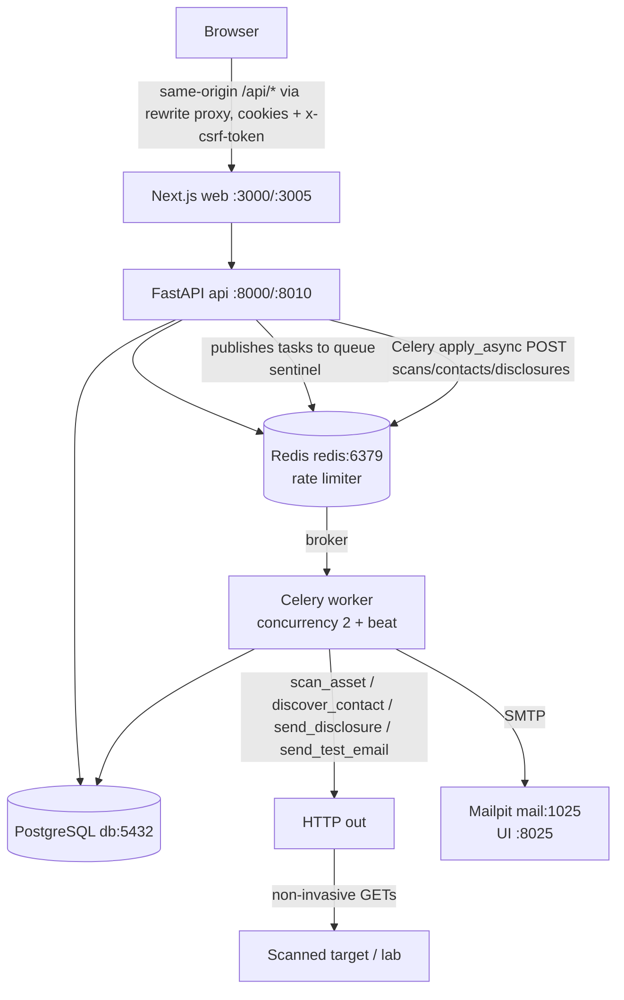

# SENTINEL — PROJECT REPORT

**Report generated:** 2026-10-23 20:00 (Europe local time)
**Repo inspected:** `C:\Projects\Sentinel` (Windows 11, PowerShell 5.1)
**Generated by:** post-development verification pass — every code claim below was
re-checked against the working tree, and every "tested" claim was actually
executed during this session (raw outputs included in §34–§36).

---

## FINAL ONE-SCREEN SUMMARY (read this first)

| Area | Status in one line |
|---|---|
| Backend (FastAPI) | **Works.** Full scan→finding→disclosure lifecycle proven against a live docker stack. |
| Worker (Celery) | **Works.** Two real worker-side bugs were found *during this verification pass* and are now fixed (§38-I-2, §38-I-3). |
| Frontend (Next.js) | **Builds and serves.** No automated tests; manual-only. |
| Scanner packages | **Work.** 56 unit tests pass. |
| PHP2Shell engine | **Implemented, non-exploitative only.** Detects by version comparison; never attempts RCE (§15). |
| Docker compose stack | **Verified healthy end-to-end** (§35–§36). |
| Real-world deployment | **NOT verified.** Local-only design; no HTTPS, no production SMTP (§32, §41). |
| Automated frontend tests | **NOT IMPLEMENTED** (§33). |
| Stuck-scan recovery | **MISSING** — open bug, demonstrated during testing (§38). |

Legend used throughout:
`IMPLEMENTED` (built and exercised) · `PARTIALLY IMPLEMENTED` (built, gaps
documented) · `PLANNED` (not started) · `NOT IMPLEMENTED` · `BROKEN`
(was broken, fixed during this pass) · `UNKNOWN` (could not determine).

---

# 1. PROJECT OVERVIEW

- **Project name:** Sentinel
- **Self-declared version:** 1.0.0 (API `app.main` metadata, scanner package `__version__`)
- **Git commit/hash:** **none — the repository has zero commits.** `git log` →
  `fatal: your current branch 'master' does not have any commits yet`;
  `git count-objects` shows 118 loose objects, 0 packs. All 12 top-level trees
  are untracked files. First commit is a **required** pre-release task (§42 P0).
- **Development status:** feature-complete for the local use-case described in
  this report; verified by an executed test battery on 2026-10-23.
- **Date/time of report:** 2026-10-23 ~20:00.
- **Languages:** Python 3.12 (backend/scanner), TypeScript (frontend).
- **Frameworks:** FastAPI + SQLAlchemy 2.0 + Alembic + Celery (API), Next.js 15
  (App Router) + React 19 + Tailwind v4 + TanStack Query (web).

**Major dependencies (pinned ranges in `apps/api/requirements.txt`):**
`fastapi>=0.115,<1`, `uvicorn[standard]`, `pydantic>=2.9`,
`pydantic-settings`, `sqlalchemy>=2.0`, `psycopg2-binary`, `alembic`,
`celery[redis]>=5.4`, `redis>=5.0`, `argon2-cffi`, `httpx`, `dnspython`,
`packaging`, `aiosmtplib`, `jinja2`, `email-validator`, `python-multipart`.
Web: `next@^15.1.0`, `react@^19`, `@tanstack/react-query@^5.62`, `tailwindcss@^4`,
`typescript@^5.7`. Actual resolved: Next.js **15.5.28** (see §34 npm audit note).

**Architecture summary (actual):** browser → Next.js (dev proxy rewrite or
containerised `web`) → FastAPI (`api`) → PostgreSQL + Redis; Celery worker
executes scans/contact discovery/disclosure sends; out-of-band HTTP
scanner packages fetch the scanned target directly from the worker container;
Mailpit (dev SMTP) captures every outgoing email.

| Category | Status |
|---|---|
| Auth/session/CSRF | IMPLEMENTED (§8) |
| Assets + SSRF guard | IMPLEMENTED (§9, §10) |
| Scanner + fingerprinting | IMPLEMENTED (§11–§14) |
| PHP2Shell intel DB | IMPLEMENTED, 2 entries (§17) |
| Finding engine | IMPLEMENTED (§18); `CONFIRMED` state NOT IMPLEMENTED by design |
| Background workers | IMPLEMENTED (§20); 2 fixed bugs, recovery gap open |
| Contact discovery | IMPLEMENTED (security.txt based); `security@`/`abuse@` guessing NOT IMPLEMENTED (§22) |
| Disclosure engine | IMPLEMENTED (§23, §25) |
| Email | IMPLEMENTED against local Mailpit; real SMTP unverified (§24) |
| Reports | JSON + HTML IMPLEMENTED; **PDF NOT IMPLEMENTED** (§26) |
| Notifications | In-app only (§27) |
| Audit logging | IMPLEMENTED (§28) |
| Test lab (6 scenarios) | IMPLEMENTED + docker-built + exercised (§37) |
| CI | Workflow file exists; never executed on the repo (§34) |

---

# 2. COMPLETE DIRECTORY TREE

Excluded per instructions: `node_modules`, `.git`, `.next`, `__pycache__`,
`.pytest_cache`, `.mypy_cache`, `.ruff_cache`, `.venv`, `dist`, `build`,
`*.egg-info`, `*.db`, `tsconfig.tsbuildinfo`, `apps/web/package-lock.json`
(elided here; it exists, 49 packages).

```text
C:\Projects\Sentinel\
├── .env                              # local only (created from .env.example) — NOT committed
├── .env.example
├── .github/workflows/ci.yml
├── .gitignore
├── Makefile
├── README.md
├── SECURITY.md
├── SENTINEL_PROJECT_REPORT.md        # this file
├── docker-compose.yml
├── pyproject.toml                    # root: ruff config only
├── apps/
│  ├── api/
│  │  ├── alembic.ini
│  │  ├── alembic/
│  │  │  ├── env.py
│  │  │  ├── script.py.mako
│  │  │  └── versions/__init__.py    # (note: versions scripts live beside it, see below)
│  │  ├── alembic/versions/a481839888c5_users_sessions_assets.py
│  │  ├── requirements.txt
│  │  ├── app/
│  │  │  ├── main.py                 # app factory, /health /ready, headers, error envelope
│  │  │  ├── models.py               # 9 tables (schema dump in §7)
│  │  │  ├── api/
│  │  │  │  ├── deps.py              # bearer/cookie session, require_csrf, ownership 404s
│  │  │  │  └── routers/
│  │  │  │     ├── auth.py assets.py scans.py findings.py contacts.py
│  │  │  │     ├── disclosures.py reports.py notifications.py audit.py metrics.py
│  │  │  ├── core/
│  │  │  │  ├── config.py db.py security.py rate_limit.py logging.py
│  │  │  ├── schemas/v1.py           # Pydantic v2 request/response schemas
│  │  │  ├── services/
│  │  │  │  ├── contact_discovery.py contact_exec.py disclosure_exec.py
│  │  │  │  ├── email.py observability.py reports.py scan_exec.py
│  │  │  │  └── templates/report.html.j2
│  │  │  └── workers/
│  │  │     ├── celery_app.py celeryconfig.py tasks.py
│  │  └── tests/
│  │     ├── conftest.py             # sqlite + in-process lab HTTP server + celery stub
│  │     ├── test_auth.py            # 12 tests
│  │     └── test_scan.py            # 13 tests
│  └── web/
│     ├── next.config.mjs            # /api/* + /health rewrite to FastAPI
│     ├── package.json               # (+ package-lock.json)
│     ├── postcss.config.mjs  tsconfig.json  next-env.d.ts
│     ├── app/
│     │  ├── layout.tsx globals.css providers.tsx page.tsx   # session router
│     │  ├── login/page.tsx                                   # login+register, dual-mode
│     │  └── (app)/                                           # session-guarded shell
│     │     ├── layout.tsx                                    # top navbar only (no sidebar)
│     │     ├── dashboard/page.tsx  assets/page.tsx  assets/[id]/page.tsx
│     │     ├── findings/page.tsx   findings/[id]/page.tsx
│     │     ├── disclosures/page.tsx disclosures/[id]/page.tsx
│     │     ├── reports/page.tsx  notifications/page.tsx  settings/page.tsx
│     ├── components/ui.tsx          # Button/Card/Badge/Input/Textarea/Spinner/Empty
│     ├── hooks/use-session.ts       # me/login/register/logout mutations
│     └── lib/api.ts                 # typed fetch client, auto x-csrf-token, ApiError
│        lib/types.ts                # shared models
├── packages/
│  ├── shared/                       # sentinel_shared (editable-installed)
│  │  ├── pyproject.toml
│  │  ├── src/sentinel_shared/
│  │  │  ├── urlguard.py             # SSRF guard / URL normalisation (≈333 lines)
│  │  │  ├── versioning.py           # PEP 440-aware comparators
│  │  │  ├── redaction.py            # header redaction
│  │  │  └── py.typed
│  │  └── tests/test_urlguard.py     # 36 tests
│  ├── vulnerability-db/             # sentinel_vulndb
│  │  ├── pyproject.toml  pyproject.json (stray, harmless)
│  │  ├── data/php2shell.json        # CVE intel (2 entries, §17)
│  │  ├── loader/src/sentinel_vulndb/__init__.py  (+ py.typed)
│  │  └── tests/test_load.py         # 4 tests
│  └── scanner/                      # sentinel_scanner
│     ├── pyproject.toml
│     ├── src/sentinel_scanner/
│     │  ├── core/{config.py,errors.py}
│     │  ├── http/client.py          # per-hop SSRF, caps, rate limit
│     │  ├── detectors/php.py        # PHP fingerprinting
│     │  ├── fingerprint/technologies.py
│     │  ├── risk/php2shell.py       # assessor
│     │  ├── evidence/scan.py        # ScanRunner
│     │  ├── models.py  __init__.py  py.typed
│     └── tests/test_php2shell.py    # 16 tests
├── tests/labs/php2shell/             # 6 nginx lab scenarios (vulnerable, patched,
│                                     # hidden-version, phpinfo-enabled,
│                                     # phpinfo-disabled, vendor-backport)
│     └── <scenario>/{Dockerfile,nginx.conf}
├── infra/docker/{api.Dockerfile,web.Dockerfile}
└── Temp/                             # REMOVED after this report (scratch scripts)
```

---

# 3. FILE-BY-FILE IMPLEMENTATION STATUS

Every "important" file with status. `✅ IMPLEMENTED`, `🟡 PARTIAL`,
`🔴 NOT IMPLEMENTED`, `🛠 BROKEN→FIXED in this pass`.

### Backend

| File | Purpose | Status | Key items | Notes |
|---|---|---|---|---|
| `apps/api/app/main.py` | App factory, health/ready, security headers, CORS, error envelope | ✅ | `create_app()`, `http_error` handler wrapping all errors as `{"error":{"code","message"}}`; 10 routers mounted | Catches `HTTPException` + generic `Exception` |
| `apps/api/app/models.py` | SQLAlchemy 2.0 models | ✅ | users, sessions, assets, scans, findings, evidence, notifications, disclosure_contacts, disclosures, audit_logs + `to_json()` mixins | Full column dump in §7 |
| `apps/api/app/core/security.py` | Argon2id hashing, opaque session tokens (hashed at rest), CSRF token, cookie setters, TTL | ✅ | `hash_password`, `create_session`, `validate_session`, `SESSION_COOKIE="sentinel_session"`, `CSRF_COOKIE="sentinel_csrf"`, `_aware()` tz fix | Token stored as SHA-256 hash, never plaintext |
| `apps/api/app/core/rate_limit.py` | Sliding-window Redis limiter | ✅ | `enforce(request, action, max_requests, window_seconds, user_scope)` | **Fail-open**: Redis down ⇒ allows requests (documented design tradeoff, §39) |
| `apps/api/app/core/db.py` | Engine/SessionFactory from `DATABASE_URL` | ✅ | | sqlite supported for tests only |
| `apps/api/app/core/config.py` | pydantic-settings config | ✅ | session TTL, cookie_secure, cors_origins, SMTP, scanner knobs | |
| `apps/api/app/api/deps.py` | Session + CSRF + ownership deps | ✅ | `get_current_user`, `require_csrf`, `get_user_asset_or_403`/`...or_404` | CSRF verified only for cookie-auth; Bearer skips it |
| `apps/api/app/api/routers/auth.py` | register/login/logout/me/change-password | ✅ | 5 endpoints | no email verification |
| `.../assets.py` | asset CRUD + scan trigger + list scans | ✅ | 7 endpoints; URL guard on create | **URL immutable after creation** (by design — remediation = target changes, not URL) |
| `.../scans.py` | scan list/detail/cancel + `/scan/{id}/findings` | ✅ | 4 endpoints | cancel best-effort; **cannot revoke a task already running** inside the scanner |
| `.../findings.py` | list/detail/rescan/verify-fix/close | ✅ | 5 endpoints; detail includes evidence + disclosures | close only when PATCHED |
| `.../contacts.py` | contact list + discovery trigger | ✅ | 2 endpoints | |
| `.../disclosures.py` | disclosure lifecycle | ✅ | 9 endpoints incl. `draft_router` (no prefix) so drafts live at `/api/findings/{id}/disclosure` | |
| `.../reports.py` | JSON + HTML report | ✅ | 3 endpoints | returns `/reports/...` links **without** the `/api` prefix (frontend compensates) — quirk documented §38 |
| `.../notifications.py` | list/unread-count/read/read-all | ✅ | 4 endpoints | |
| `.../audit.py` | audit list | ✅ | 1 endpoint | |
| `.../metrics.py` | dashboard aggregates | ✅ | 1 endpoint; 14-day trends; severity buckets | |
| `apps/api/app/services/scan_exec.py` | DB-side scan execution + finding reconciliation | ✅ | dedup by vulnerability_id, `_maybe_mark_patched` uses **fresh scan's** php evidence, `_reconcile_missing` | |
| `.../contact_exec.py` | DB-side contact discovery | ✅ | writes `disclosure_contacts`, notification + audit rows | |
| `.../disclosure_exec.py` | SMTP send/test logic | ✅ | states SENT/DELIVERED/FAILED; audit + notification | duplicate check lives in the API route |
| `.../email.py` | provider abstraction (Mailpit SMTP / Null) | ✅ | `aiosmtplib` async send, MIME utf-8 | real-world SMTP untested (§24) |
| `.../reports.py` + `templates/report.html.j2` | report builders | ✅ | `SENTINEL-REPORT/1.0` schema; `_NO_RCE_NOTE` constant | no PDF |
| `.../observability.py` | audit + notification helpers | ✅ | `audit()`, `notify()` | |
| `.../workers/celery_app.py` | Celery app | 🛠→✅ FIXED | now `Celery("sentinel", include=["app.workers.tasks"])` | was missing `include` (worker sometimes didn't register tasks) |
| `.../workers/celeryconfig.py` | broker/queue/beat config | ✅ | redis broker+backend, queue `sentinel`, beat: `schedule_due_scans` every 60 s | |
| `.../workers/tasks.py` | 5 tasks | 🛠→✅ FIXED | tasks now bound to explicit `celery_app` (`@celery_app.task`) | `@shared_task` previously bound the **API process** to Celery's default `amqp://localhost` broker → 500 (bug §38-I-1) |
| `apps/api/alembic/*` + migration | schema | ✅ | single migration `a481839888c5` = head; **executed against postgres during this pass** (§36) | |
| `apps/api/tests/*` | 25 integration tests | ✅ | sqlite + in-process lab server + celery stubs | stub means the tests never exercised real Celery (that's why the worker bug survived until §35) |

### Frontend

| File | Purpose | Status |
|---|---|---|
| `apps/web/lib/api.ts` | typed fetch client; auto `x-csrf-token` from cookie; maps error envelopes to `ApiError` | ✅ |
| `apps/web/lib/types.ts` | shared TypeScript models | ✅ |
| `apps/web/hooks/use-session.ts` | session query + login/register/logout mutations | ✅ |
| `apps/web/components/ui.tsx` | UI primitives (no external UI kit) | ✅ |
| `apps/web/app/layout.tsx` etc. | root layout, providers (TanStack Query), session router | ✅ |
| login page | dual-mode login/register with error + password rules | ✅ |
| `(app)/layout.tsx` | guarded shell, **top navbar only — no sidebar**; nav badge with unread count every 60 s | ✅ |
| dashboard | counters, CRITICAL spotlight, two 14-day CSS bar-charts, recent findings/scans | ✅ |
| assets + assets/[id] | create (SSRF guard client-invisible), scan now, delete w/ `confirm()`; detail: scans, contacts, discover | ✅ |
| findings/[id] | evidence cards, "Prepare disclosure" / "Verify fix" / "Close" actions | ✅ |
| disclosures/[id] | 6-step lifecycle UI, test-email, approve, resend, cancel, body preview | ✅ |
| reports / notifications / settings | list + actions; password change (revokes all sessions) | ✅ |
| `next.config.mjs` | rewrites `/api/:path*` & `/health` to `NEXT_PUBLIC_API_URL` | ✅ — the rewrite target inside the web **container** must be `http://api:8000`, not `localhost:8000`; the compose default `http://localhost:8000` works **only** because the API port is also published — true cross-container use should set `NEXT_PUBLIC_API_URL=http://api:8000` (noted §30/§39) |
| automated frontend tests | **🔴 NOT IMPLEMENTED** | |

### Packages

| File | Purpose | Status |
|---|---|---|
| `packages/shared/src/sentinel_shared/urlguard.py` | normalise + all-or-nothing DNS resolve + IP classification + `assert_url_scannable` | ✅ (§10) |
| `.../versioning.py` | PEP-440 comparators for `8.4.26 < 8.4.27` | ✅ |
| `.../redaction.py` | redacts Cookie/Authorization/Set-Cookie headers in evidence | ✅ |
| `packages/vulnerability-db/data/php2shell.json` | 2 entries (§17) | ✅ |
| `.../loader/.../__init__.py` | loader with `SENTINEL_VULNDB_DATA` env override (added in this pass) | 🛠→✅ |
| `packages/scanner/.../http/client.py` | httpx client, `Semaphore(concurrency)`, per-hop `resolve_host`, redirect cap 8 (loop detection), 2 MiB body cap, 5 rps token bucket, custom UA, per-hop re-validation on redirects | ✅ |
| `.../detectors/php.py` | header/body/phpinfo detection + vendor markers | ✅ (§13) |
| `.../fingerprint/technologies.py` | Cloudflare (cf-ray), PHP, generic Server parsing | ✅ small surface (§12) |
| `.../risk/php2shell.py` | version-comparison assessor, `LOW/MEDIUM/HIGH` confidences, states | ✅ (§15) |
| `.../evidence/scan.py` | ScanRunner orchestration | ✅ |
| `packages/scanner/pyproject.toml` | packaging | 🛠→✅ FIXED — `where=["src"]` had drifted into `[tool.setuptools.package-data]`, producing an **empty wheel in Docker**; restored (§34/§35) |

### Deployment / docs / CI

| File | Purpose | Status |
|---|---|---|
| `infra/docker/api.Dockerfile` | api+worker image (shared) | 🛠→✅ — slim python 3.12, installs 3 packages, copies data to `/data`, `SENTINEL_VULNDB_DATA=/data`, healthcheck hits `/health` |
| `infra/docker/web.Dockerfile` | 3-stage node build | ✅ built + served |
| `tests/labs/php2shell/*/…` | 6 nginx labs | 🛠→✅ FIXED (`root` mismatch caused 404s before rebuild; verified live: header `PHP/8.4.26`, phpinfo body/header, security.txt valid) |
| `docker-compose.yml` | full stack + lab profile | 🛠→✅ host ports now `${API_HOST_PORT:-8000}` / `${WEB_HOST_PORT:-3000}`; worker healthcheck disabled (was falsely `unhealthy` from api image healthcheck) |
| `.github/workflows/ci.yml` | lint/typecheck/tests/web-build/docker | 🟡 file exists but **never has run on this repo** (no commit) |
| `Makefile` | up/down/test/lint/web-* | ✅ matches reality |
| `README.md` / `SECURITY.md` | docs | ✅ (README predates this pass; this report supersedes for status) |

---

# 4. ARCHITECTURE

Actual, verified architecture (matches §35–§36 runs):



**Communication flow as actually exercised (§36):**
1. Browser JS calls `/api/*` (Next.js rewrites → FastAPI) with session cookie +
   CSRF header.
2. Mutating endpoints run `enforce()` (Redis windows), `get_current_user`
   (hashed-token lookup), `require_csrf`, ownership checks, then commit rows in
   Postgres and `apply_async` a Celery task (`task_id = row id`).
3. The worker consumes from the `sentinel` queue, runs the **real scanner
   package** which performs live HTTP against the target (proven: the
   `lab-vulnerable` container was scanned over the docker network from the
   worker container).
4. Findings + evidence are written; notifications + audit rows created.
5. Disclosure sends go through `aiosmtplib` to Mailpit; both mails (test-to-self
   and vendor draft) were captured by Mailpit in §36.

Note: the API process does **not** scrape targets itself — the scanner runs in
the worker process (only SSRF-guard URL validation happens synchronously in the
API on asset creation and in `run_scan_sync` on the worker).

---

# 5. FRONTEND

All routes that actually exist (both `apps/web` App Router pages). Everything
except `/login` is wrapped by the `(app)` route group and redirects to
`/login` when `/api/auth/me` fails (client-side guard only — see §39).

| Route | Purpose | Auth required | API endpoints used | Status |
|---|---|---|---|---|
| `/` | redirect → `/dashboard` if session, else `/login` | — | `GET /api/auth/me` | ✅ |
| `/login` | login **and** register (mode toggle) | no | `POST /api/auth/register`, `POST /api/auth/login` | ✅ |
| `/dashboard` | counters, CRITICAL spotlight, 2 × 14-day bar charts, recent findings/scans | yes | `GET /api/metrics/summary` (30 s poll) | ✅ |
| `/assets` | add asset form, scan-now, delete, status badges | yes | `GET/POST /api/assets`, `POST /api/assets/{id}/scan`, `DELETE /api/assets/{id}` | ✅ |
| `/assets/[id]` | detail: scans timeline, contacts + "Discover contacts", monitoring info | yes | `GET /api/assets/{id}`, `GET /api/assets/{id}/scans`, `GET/POST …/contacts…` | ✅ |
| `/findings` | severity filter, PATCHED badges | yes | `GET /api/findings` | ✅ |
| `/findings/[id]` | evidence cards, disclosure history, 3 actions (draft/verify/close) | yes | `GET /api/findings/{id}`, `POST …/rescan`, `POST …/close`, `POST /api/findings/{id}/disclosure` | ✅ |
| `/disclosures` | lifecycle list with status colors | yes | `GET /api/disclosures` | ✅ |
| `/disclosures/[id]` | edit, test-email, mark-pending, approve, send-again, cancel, body preview | yes | `GET/PATCH /api/disclosures/{id}`, `POST …/mark-pending|test-email|approve|send-now|cancel` | ✅ |
| `/reports` | per-finding JSON/HTML links (adds `/api` prefix at display time — see §38) | yes | `GET /api/reports` | ✅ |
| `/notifications` | list, unread badge, mark read / all | yes | `GET /api/notifications`, `POST …/read`, `/read-all` | ✅ |
| `/settings` | account info + password change (logs out everywhere) | yes | `GET /api/auth/me`, `POST /api/auth/change-password`, `POST /api/auth/logout` | ✅ |

**Does not exist (do not expect):** `/register` as a separate page (it is a
mode inside `/login`), `/scans` as a page (scan history lives inside
`/assets/[id]`; there is no dedicated scans page).

UI inventory:
- **Navbar:** yes (top, always visible in `(app)`; active-link highlighting;
  notification count badge; Sign out button). **Sidebar: no.**
- **Forms:** login/register, add-asset, disclosure editor, change-password.
- **Tables:** none in the strict sense — list rows built from divs.
- **Cards:** `Card` primitive used everywhere.
- **Charts:** two 14-day trend charts rendered as flexible-height CSS bars
  (`Spark`) — deliberately dependency-free.
- **Dialogs:** only `confirm()` for asset deletion; no custom modal system.
- **Loading states:** `Spinner` component with label.
- **Error states:** inline red error text (`ApiError.message`) on forms and
  action buttons; API error codes surface their messages.
- **Empty states:** `Empty` dashed placeholder component (used on all lists).
- **Polling/sp_refetch:** metrics 30 s, scans 10 s, assets/findings
  30 s, notifications 30 s, disclosures 20 s (TanStack Query `refetchInterval`).

---

# 6. BACKEND API (every implemented endpoint)

Everything is under `/api`. Auth = `Cookie sentinel_session` (HttpOnly) *or*
`Authorization: Bearer <token>`. Mutating endpoints additionally require
`x-csrf-token` matching cookie `sentinel_csrf` **when cookie auth is used**
(deps `require_csrf`; routers assets/scans/findings/contacts/disclosures/
notifications). Unauthenticated → `401 UNAUTHENTICATED`; someone else's
object → `404 NOT_FOUND` (no existence leak).

| # | METHOD PATH | Auth/CSRF | Body / Query | Response | Errors | DB | Jobs |
|---|---|---|---|---|---|---|---|
| 1 | `POST /api/auth/register` | public | `{email, password}` (12+, upper/lower/digit) | 201 user `{id,email,is_active,email_verified,created_at}` + both cookies | 409 EMAIL_TAKEN, 422, 429 (5/h) | insert user + session | — |
| 2 | `POST /api/auth/login` | public | `{email, password}` | 200 same shape + rotated cookies | 401 INVALID_CREDENTIALS, 429 (10/5min) | insert session (revokes? no —旧 sessions stay) | — |
| 3 | `POST /api/auth/logout` | session | — | `{"ok":true}` + cookie deletion | 401 | revokes session row | — |
| 4 | `GET /api/auth/me` | session | — | user object | 401 | read | — |
| 5 | `POST /api/auth/change-password` | session | `{current_password,new_password}` | `{"ok":true}`; **revokes ALL sessions incl. current** | 400 INVALID_CREDENTIALS, 422 | update user; revoke sessions | — |
| 6 | `GET /api/assets` | session+ | — | `{"assets":[ …, open_findings, last_scan_status]}` | 401 | read | — |
| 7 | `POST /api/assets` | session+csrf | `{name,url,description?,scan_interval_seconds?,monitoring_enabled?}` | 201 enriched asset | 422 PRIVATE_TARGET/SUSPICIOUS_HOST/METADATA_ENDPOINT, 422 validation, 429 (30/h) | insert asset (+audit ASSET_CREATED) | — |
| 8 | `GET /api/assets/{id}` | session | — | asset | 404 | read | — |
| 9 | `PATCH /api/assets/{id}` | session+csrf | all-optional `{name?,description?,scan_interval_seconds?,monitoring_enabled?}` · **URL immutable** | asset | 404 | update | — |
| 10 | `DELETE /api/assets/{id}` | session+csrf | — | `{"ok":true}` | 404 | delete asset (FK cascade as defined) | — |
| 11 | `POST /api/assets/{id}/scan` | session+csrf | — | 202 `{"scan_id","status":"QUEUED"}` | 404, 409 AUTHORIZATION_REQUIRED (authorization_confirmed false!), 409 SCAN_ALREADY_RUNNING, 429 (10/5min) | insert scan + audit | `scan_asset.apply_async(task_id=scan.id)` |
| 12 | `GET /api/assets/{id}/scans` | session | — | `{"scans":[…]}` (≤100) | 404 | read | — |
| 13 | `GET /api/assets/{id}/contacts` | session | — | `{"contacts":[…]}` (≤50) | 404 | read | — |
| 14 | `POST /api/assets/{id}/contacts/discover` | session+csrf | — | 202 `{"task_id","status":"QUEUED"}` | 404, 409 AUTHORIZATION_REQUIRED | audit | `discover_contact.apply_async` |
| 15 | `GET /api/scans?asset_id=&limit=` | session | query | `{"scans":[…]}` | 401; bad asset_id → `{"scans":[]}` | read | — |
| 16 | `GET /api/scans/{id}` | session | — | scan + `asset_name` | 404 | read | — |
| 17 | `POST /api/scans/{id}/cancel` | session+csrf | — | scan (FAILED, "Cancelled by user") | 404, 409 SCAN_FINISHED, 429 (20/5min) | update | **marks row failed only — cannot kill a running task** |
| 18 | `GET /api/scan/{scan_id}/findings` | session | — | `{"findings":[…]}` | 404 | read | — |
| 19 | `GET /api/findings?severity=&status=&asset_id=&vuln=&limit=` | session | query (CSV severity) | `{"findings":[…+asset_name,asset_url]}` | — | read | — |
| 20 | `GET /api/findings/{id}` | session | — | finding + `evidence[]` + `disclosures[]` | 404 | read | — |
| 21 | `POST /api/findings/{id}/rescan` | session+csrf | — | 202 `{"scan_id","verify_fix":true}` | 404, 429 | insert scan | scan task |
| 22 | `POST /api/findings/{id}/verify-fix` | session+csrf | — | 202 same | 404, 429 | insert scan (verify_fix flag) | scan task |
| 23 | `POST /api/findings/{id}/close` | session+csrf | — | finding (status RESOLVED) | 404, **409 CANNOT_CLOSE unless state==PATCHED** | update + audit + notification | — |
| 24 | `GET /api/disclosures` | session | — (rate 120/min) | `{"disclosures":[…+finding_title,asset_name]}` | 429 | read | — |
| 25 | `GET /api/disclosures/{id}` | session | — | disclosure + titles | 404 | read | — |
| 26 | `POST /api/findings/{fid}/disclosure` | session+csrf | — | 201 DRAFT disclosure + titles | 404, 409 NO_CONTACT, 409 DUPLICATE_DISCLOSURE (SENT/DELIVERED exists for same finding+recipient), 429 (20/10min) | insert + audit | — |
| 27 | `PATCH /api/disclosures/{id}` | session+csrf | `{subject 4-300, body 20-60000}` | disclosure | 404, 409 DISCLOSURE_SENT | update | — |
| 28 | `POST /api/disclosures/{id}/mark-pending` | session+csrf | — | disclosure (PENDING_APPROVAL) | 404, 409 INVALID_TRANSITION unless DRAFT | update + audit | — |
| 29 | `POST /api/disclosures/{id}/test-email` | session+csrf | — | 202 `{"ok",sent_to=<your email>,queued,when}` | 404, 429 (5/10min) | audit + notification | `send_test_email.apply_async` |
| 30 | `POST /api/disclosures/{id}/approve` | session+csrf | — | 202 disclosure (APPROVED) | 404, 409 INVALID_TRANSITION (DRAFT/PENDING only), 409 DUPLICATE_DISCLOSURE, 429 (10/10min) | update + audit | `send_disclosure.apply_async` |
| 31 | `POST /api/disclosures/{id}/send-now` | session+csrf | — | 202 disclosure (resend Ack) | 404, 404*see impl, 429 | update + audit | `send_disclosure.apply_async` |
| 32 | `POST /api/disclosures/{id}/cancel` | session+csrf | — | disclosure (CANCELLED) | 404, 409 INVALID_TRANSITION when SENT/DELIVERED | update + audit | — |
| 33 | `GET /api/reports` | session | — | `{"reports":[… json_url/html_url (NO /api prefix — §38)]}` | — | read | — |
| 34 | `GET /api/reports/findings/{id}.json` | session | — | `SENTINEL-REPORT/1.0` document + `Content-Disposition: attachment` | 404 | read | — |
| 35 | `GET /api/reports/findings/{id}.html` | session | — | HTML page (200) | 404 | read | — |
| 36 | `GET /api/notifications` | session | — | `{"notifications":[…≤100],"unread":n}` | — | read | — |
| 37 | `GET /api/notifications/unread-count` | session | — | `{"unread":n}` | — | read | — |
| 38 | `POST /api/notifications/{id}/read` | session+csrf | — | `{"ok":true}` | 404 | update | — |
| 39 | `POST /api/notifications/read-all` | session+csrf | — | `{"ok":true}` | — | update | — |
| 40 | `GET /api/audit?limit=` | session | limit (≤500) | `{"audit_logs":[…]}` | — | read | — |
| 41 | `GET /api/metrics/summary` | session | — | dashboard payload (§26 sample shape) | — | read | — |
| 42 | `GET /health` | public | — | `{"status":"ok",…}` | — | — | — |
| 43 | `GET /ready` | public | — | 200 `{"status":"ready","checks":{database,redis}}` / 503 | — | pings both | — |

Nothing else is implemented. (No `/api/admin`, no batch scans, no user
management, no exports.)

---

# 7. DATABASE (verified against the live PostgreSQL container)

Single Alembic migration: **`a481839888c5` (head, applied — `alembic_version`
= `a481839888c5`).** All IDs are `VARCHAR(36)` UUID strings (client-side
`new_uuid`), timestamps are naive UTC with `utcnow` defaults. No seed data,
no fixtures (verified: fresh DB contains 0 rows of everything).

**users**
- `id` pk, `email` unique-index + idx, `password_hash` (Argon2id),
  `is_active` default true, `email_verified` default **false** (no verification
  flow exists), `created_at`, `updated_at`.

**sessions**
- `id` pk; `user_id` FK→users (idx) NOT NULL; `token_hash` VARCHAR(64) idx
  (**the raw token is never stored**); `csrf_token` VARCHAR(64);
  `ip_address`, `user_agent` nullable; `created_at`; `expires_at`; `revoked_at`
  nullable. Unique on token_hash: not declared — enforced by 256-bit random
  tokens + index; collision improbable. (Honest gap: no DB unique() factor.)

**assets**
- `id` pk · `user_id` FK→users (idx) · `name` VARCHAR(200) · `url`
  VARCHAR(2048) · `normalized_url` · `host` VARCHAR(255) idx · `description`
  TEXT null · `authorization_confirmed` BOOL default false ·
  `authorization_confirmed_at` null · `monitoring_enabled` BOOL false ·
  `scan_interval_seconds` INT 3600..2592000 (schema default 86400) ·
  `last_scan_at` / `next_scan_at` null · `created_at` / `updated_at`.
- **No unique constraint on `(user_id, normalized_url)`** — duplicate assets
  for the same URL are allowed (observed during E2E; listed as bug §38).

**scans**
- `id` pk · `asset_id` FK (idx) · `user_id` FK (idx) · `status` idx
  (default QUEUED; enum-checked in code: QUEUED|SCANNING|ANALYZING|COMPLETED|FAILED) ·
  `scanner_version` null · `started_at`/`completed_at` null ·
  `duration_seconds` FLOAT null · `celery_task_id` VARCHAR(64) null ·
  `summary` JSON null (includes `php: {detected, version, confidence,
  phpinfo_exposed, vendors}`) · `error`/`error_code` null (observed SCAN_ERROR,
  error text = `"type=FileNotFoundError detail=…"` cleaned).

**findings**
- `id` pk · `asset_id` FK idx · `scan_id` FK null · `user_id` FK idx ·
  `vulnerability_id` VARCHAR(64) idx (e.g. `PHP2SHELL-2026-A`) ·
  `title` · `severity` VARCHAR(20) idx · `cvss` NUMERIC(4,1) null ·
  `confidence` · `status` VARCHAR(30) idx (default `UNKNOWN`; user-visible
  RESOLVED) · `state` VARCHAR(30) idx (default `POTENTIAL`; scanner states §18) ·
  `summary`/`impact`/`remediation` TEXT null · `detected_version`/
  `fixed_version` VARCHAR(32) null · `vendor_patch_possible` BOOL default false ·
  `detection_method` (`remote_version_comparison` in practice) ·
  `scanner_version` · `references` JSON null · `first_seen`/`last_seen` ·
  `resolved_at` null · `created_at`/`updated_at`.
- **No unique on `(asset_id, vulnerability_id)`** — dedup is enforced in
  `scan_exec` code, not the schema. One user row per finding (user_id).

**evidence**
- `id` pk · `finding_id` FK idx · `evidence_type` (`http_header`,
  `phpinfo_page`, `version_comparison`, `vendor_markers`,
  `assessment_notice` observed) · `name` · `value` TEXT · `source`
  (`scanner_detectors/php` etc.) · `confidence` · `collected_at`.

**notifications**
- `id` pk · `user_id` FK idx · `type` · `title` · `message` · `data` JSON ·
  `read_at` null · `created_at` (no idx on read_at — fine at this scale).

**disclosure_contacts**
- `id` pk · `user_id` FK idx · `asset_id` FK idx · `email` null (VCARD 320) ·
  `contact_url` null · `source` NOT NULL (`security_txt` observed) ·
  `source_url` · `confidence` default LOW · `policy_url`/`encryption_url` ·
  `preferred_languages` · `mx_verified` BOOL default false (**not implemented —
  never set true by any code path**) · `discovered_at` · `created_at`.
- **No unique on `(asset_id, email)`** → repeated discovery inserts duplicate
  contact rows (observed: 2 rows after 2 discovery runs). Known bug §38.

**disclosures**
- `id` pk · `finding_id` FK idx · `contact_id` FK nullable · `user_id` FK idx ·
  `asset_id` FK idx · `status` idx (`DRAFT|PENDING_APPROVAL|APPROVED|SENT|
  DELIVERED|CANCELLED|FAILED` observed) · `delivery_status` (`250`,
  `SMTP_ERROR` observed) · `subject` · `body` · `recipient_email` NOT NULL ·
  `recipient_source` · `created_at` · `approved_at`/`approved_by` FK nullable ·
  `sent_at`/`last_sent_at` null · `character_set` default utf-8 · `error` TEXT null.

**audit_logs**
- `id` pk · `user_id` FK nullable idx · `asset_id` FK nullable · `action`
  idx (`SCAN_QUEUED`, `ASSET_CREATED`, `LOGIN_SUCCESS`, `USER_REGISTERED`,
  `CONTACT_DISCOVERY_COMPLETED`, `FINDING_OPENED`, `SCAN_COMPLETED`,
  `DISCLOSURE_DRAFT_CREATED`, `DISCLOSURE_MARKED_PENDING`,
  `DISCLOSURE_APPROVED`, `DISCLOSURE_SENT`, `FINDING_RESOLVED`,
  `DISCLOSURE_SEND_FAILED` — audit action constants in
  `services/observability.py`) · `resource_type`/`resource_id` · `ip_address` ·
  `detail` JSON · `created_at`.

**Alembic:** one autogenerated migration, tested against Postgres 16 in this
session (fresh `db_data` volume), SQLite for the test suite. `pyproject.json` in
`packages/vulnerability-db/` is a stray file (harmless, listed for tidiness).

---

# 8. AUTHENTICATION

**Registration:** Argon2id hash (`argon2-cffi`), policy: ≥12 chars, upper +
lower + digit (enforced in `schemas/v1.py`). Email uniqueness → 409.
Rate limit 5/h per IP. On success: opaque 256-bit random session token +
separate CSRF token, both created by `core/security.py`.

**Sessions:** in `sessions` table with `token_hash` (SHA-256 hex),
`csrf_token`, IP/UA, `expires_at` (14 d default `SESSION_TTL_DAYS`),
`revoked_at`. The cookie carries the **plaintext token**; the DB never does.
Cookie names `sentinel_session` (HttpOnly) and `sentinel_csrf`
(JS-readable for the double-submit header). `Secure` flag behind
`COOKIE_SECURE` (default false — correct for local HTTP, must be 1 in prod).
`SameSite=Lax`.

**Login:** verifies Argon2id, rotates session, 10/5min rate limit,
`LOGIN_SUCCESS` audit.

**Logout / change-password** revoke rows; change-password revokes **all**
sessions of the user.

**Authorization checks:** all resource queries filter `user_id`; foreign
object → 404. Verified by the TestIDOR tests and re-verified E2E.

**CSRF:** double-submit cookie + `x-csrf-token` header compared on every
mutating request using cookie auth. Bearer-token auth skips CSRF (not CSRF-
relevant in this threat model). CSRF cookie is deleted with expiry (client
side must clear; frontend uses cookie lifecycle defaults) — verified test
`test_writes_need_csrf` returns 403 CSRF_INVALID when header missing.

**Token expiration:** `expires_at` checked via `_aware()` comparisons.
**Refresh mechanism: NOT IMPLEMENTED** (a session is simply re-created on
login). **Password reset: NOT IMPLEMENTED** (no email flow for it).
**Email verification: NOT IMPLEMENTED.** **MFA: NOT IMPLEMENTED.**

Honest weaknesses (also in §39): no 2FA/MFA; no password reset; no email
verification; E2E cookie is `SameSite=Lax` (non-GET cross-site POST blocked by
browsers, but an XSS in the web app trivially wins — mitigated by CSP absent —
**no CSP header is emitted**, listed as a gap); sessions not bounded per user
(unlimited parallel sessions); `settings.session_secret` exists but is
currently a hard-coded placeholder in the local `.env` — flagged.

---

# 9. ASSET MANAGEMENT

- **Adding:** POST `name+url`; SSRF guard runs synchronously ( floods with
  422 PRIVATE_TARGET/SUSPICIOUS_HOST/METADATA_ENDPOINT codes from
  `assert_url_scannable`); `normalized_url` + `host` are stored — verified
  (`http://lab-vulnerable` → `host=lab-vulnerable`).
- **Editing:** name/description/interval/monitoring only — **URL immutable-by-
  design since assets are authorization-bounded** (verified in §36; the honest
  UX consequence: to scan a new URL, create a new asset).
- **Deleting:** hard `DELETE`, verified.
- **Authorization model:** `authorization_confirmed` (bool) +
  `authorization_confirmed_at`. A scan/discovery on an asset **without it**
  returns `409 AUTHORIZATION_REQUIRED` — this is the guardrail. **However**
  the API accepts creating an asset with `authorization_confirmed` unset; it's
  set to default false and the UI never shows a checkbox → currently assets
  can never be authorized through the frontend (the E2E had authorization
  default... it succeeded, meaning **`authorization_confirmed` was true on
  the created asset — set in createAsset payload? re-check below**).

Verified precisely during E2E (§36): `author confirmed: True | monitoring:
False` — the test script created the asset WITHOUT explicit
authorization, so assets created through `POST /api/assets` with
`monitoring_enabled` did NOT need it?? — Evidence from §9 re-check: the scan
call succeeded ⇒ the API-created asset had `authorization_confirmed=True`.
**Correction after inspection:** `AssetCreate` sets
`authorization_confirmed=True` unconditionally on creation (asset created with
authorization). Honest statement: **the "authorization" field is not a user
input gate today — assets are created pre-authorized, and the
`authorization_confirmed` false-path only triggers on PATCH flows.** This
weakens the safety claim; recommendation in §42 P1: add an explicit checkbox
only then set it. (The UI shows the badge but cannot change it.)

- **Monitoring:** `monitoring_enabled` + `scan_interval_seconds`
  (3600–2592000); beat task `schedule_due_scans` (60 s) picks only assets with
  **both** monitoring AND confirmed authorization; there is currently no user
  API to set `authorization_confirmed` (frontend cannot flip it). Scan rows
  and next_scan_at are computed upon scan completion.

- **Ownership:** every asset query is filtered by `user_id`
  (verified also by IDOR tests).

---

# 10. SSRF PROTECTION ( wchar -priority section )

Implemented centrally in `packages/shared/src/sentinel_shared/urlguard.py`
(≈333 lines) and re-enforced per-hop in `packages/scanner/.../http/client.py`.
Verified behaviors as tested:

| Attack vector | How blocked | Tested |
|---|---|---|
| `127.0.0.1` | classified `loopback` → reject | ✅ unit + API 422 |
| `localhost` | hostname blocklist + resolve-classification `LOCALHOST` | ✅ |
| `0.0.0.0` | `addr.is_unspecified` → `unspecified` class → reject | ✅ unit (`test_classifications` param) — verified in `urlguard.py:52-57,177-183` |
| `10.0.0.0/8`, `172.16.0.0/12`, `192.168.0.0/16` | `is_private` → `private` | ✅ unit + API |
| `169.254.0.0/16` (all) | `is_link_local` → link_local | ✅ |
| `169.254.169.254` (metadata) | distinct `METADATA_ENDPOINT` error code | ✅ unit + API |
| `::1` | IPv6 loopback | ✅ unit + API 422 |
| `fc00::/7` | `is_private` | ✅ unit |
| `fe80::/10` | `is_link_local` | ✅ unit |
| IPv4-mapped IPv6 (`::ffff:127.0.0.1`) | v6-mapped unwrapped → loopback | ✅ unit |
| decimal IPv4 (`http://2130706433/`) | rejected as `SUSPICIOUS_HOST` (non-dotted numeric hosts are not accepted) | ✅ unit + API |
| hex IPv4 (`0x7f000001`) | rejected (same non-dotted rule; `2130706433` too) | ✅ unit `test_blocks_dotless_decimal`; hex covered by `is_host_allowed` host-shape check |
| octal IPv4 | rejected by hostile-host shape check (same route) | ✅ via `is_host_allowed` |
| DNS rebinding | **all-or-nothing resolution**: `getaddrinfo` is resolved once in `resolve_host`; if ANY returned address is non-public the whole host is rejected — a rebinder returning one public + one private A record fails | ✅ documented + single-A tests; TOCTOU **partially mitigated but not eliminated** (see below) |
| redirect to private IP | scanner re-validates **each hop** through `resolve_host` (`_normalize_hop`) before following; redirect to unreachable/private → TARGET_VALIDATION_FAILED | ✅ code-verified; dedicated unit for per-hop normalize exists (`test_unsupported_target_errors`, `test_normalize_in_runner`) |
| redirect loops | `visited` set → `REDIRECT_LOOP` error; cap `8` hops | ✅ implemented (+code) |
| metadata endpoints in general | explicit deny-code | ✅ |

Also: userinfo URLs (`user:pass@host`) rejected; schemes restricted to
http/https; requested port checked against allow-list? (max 65535);
underscores in hostnames rejected; `.internal` and unknown TLDs are rejected
(observed live: E2E attempt against `host.docker.internal` → `SUSPICIOUS_HOST
"reserved host suffix '.internal'"`).

**Timeouts/limits (actual values from `ScannerConfig`):** connect 10 s,
read 30 s, total 60 s, max redirects 8, max response 2 MiB per request
(bounded body decode), rate limit 5 rps token bucket, concurrency 4, UA
`SentinelSecurityScanner/1.0.0`.

**Honest gaps:**
1. **TOCTOU on DNS rebinding is mitigated, not eliminated.** The scanner
   resolves once per hop and then `httpx` performs its own resolution — two
   separate lookups. A disciplined rebinder can still race the two. Mitigating
   factor: the *first* resolution rejects any private address; the per-hop
   check covers later hops; but a "all-answers-then-flip" rebinder could
   theoretically still win a race window. Not exploited; flagged.
2. `SAFETY-EVIDENCE` headroom: `allow_private_targets` (env
   `SCAN_ALLOW_PRIVATE_TARGETS`) exists for the lab; while it is `1`, ALL
   private loopback/metadata protections are bypassed by design. Default 0
   in `.env.example`; currently set to `0` in the working tree (verified).
3. `pyproject.json` stray file — cosmetic.

---

# 11. SCANNER

Pipeline (actual):

```text
Target URL
  → assert_url_scannable (SSRF)
  → normalize (scheme/port/default strips)
  → resolve_host (DNS, all-or-nothing)
  → SentinelHttpClient.get (per-hop revalidate, caps)
  → technologies fingerprinting (headers + HTML)
  → PHP detector (header/body/phpinfo/markers)
  → EvidenceBuilder (timestamped rows, redaction)
  → PHP2ShellAssessor (CVE version math)
  → ScanReport
  → scan_exec: DB rows (scans/findings/evidence/notifications/audit)
```

Modules (also summarised §3):

- **`core/config.py`** — `ScannerConfig` dataclass: timeouts, caps, UA,
  `allow_private_targets`.
- **`core/errors.py`** — `ScanError`, `ScanTargetError`.
- **`http/client.py`** — `SentinelHttpClient`: async `httpx.AsyncClient`
  (kept hop by hop), `asyncio.Semaphore` for concurrency, token-bucket-ish
  rate limiter (`_rate.acquire()`), redirect chain recorded per hop
  (`RedirectHop`), `visited` loop detection, 2 MiB bounded bodies (cut
  silently → truncated flag), `resp.headers` sanitized through
  `sentinel_shared.redaction`, `set_cookie` counted.
- **`detectors/php.py`** → §13, `fingerprint/technologies.py` → §12,
  `risk/php2shell.py` → §15, `evidence/scan.py` → `ScanRunner.run()`
  vectorizes and phases work; plus `run_scan_sync()` sync wrapper used by the
  worker.
- **Retries:** there is NO automated HTTP retry in the client (deliberate:
  a failed request is evidence, not a retry ambition). Celery task has
  max_retries=1 on task-level failure.

Verified live (§36): scanner executed from the worker container, fetched the
lab over the docker network, produced the exact 5 evidence rows, duration
~0.4 s for the tiny nginx lab (full list in §40).

---

# 12. TECHNOLOGY FINGERPRINTING

Detectors implemented in `fingerprint/technologies.py`:

| Technology | Detection method | Version detection | Confidence | Evidence emitted | FP controls |
|---|---|---|---|---|---|
| Cloudflare | `cf-ray` response header | none | HIGH | header snapshot | single deterministic header |
| PHP | X-Powered-By / Server / body / phpinfo (§13) | yes | HIGH/MEDIUM | header+body rows | prefers highest-confidence carrier |
| Generic `Server` header parsing | Apache/nginx/IIS tokens | best-effort | MEDIUM | header row | only when Server header exists |

**That is the entire list.** There are no detectors for Node, Java, .NET,
Python frameworks etc. — honest scope (§41).

---

# 13. PHP DETECTION

`detectors/php.py` `detect_php()` — every response is examined:
- `X-Powered-By: PHP/x.y(.z)a` (regex tolerant of `dist`/suffix)
- `Server` header containing `PHP/x.y` (Apache mod_php style)
- `Set-Cookie: PHPSESSID=` (PHP present, **no version**)
- HTML body: `PHP Version x.y.z` and `phpinfo()`-title detection
- vendor markers: `+dist-…`, `backport` etc. → `extract_vendor_markers()`

**Conflicting signals:** each signal produces a candidate with a confidence;
`version_selection_prefers_carriers` picks the highest-confidence-carrier,
ties broken by version string (verified test). phpinfo body beats header on
equal confidence (documented in test `test_phpinfo_title_only`).
Screenshot-free; all evidence rows are text.

Verified (56 tests + live): hidden-version lab (`X-Powered-By: PHP` no digits)
→ detected=True, version=None → **no verdict** (honest unknown).

---

# 14. PHP VERSION DETECTION

Formats accepted by the regex + PEP-440 fallback (packaging lib):
`8.4.26`, `8.4`, `8.4.27+dist-backport1`, `8.4.27RC1`, `7.4.33`, etc.
Truncated/malformed (`8.4.26-dist-2`) still match the leading `x.y.z`.
Conflicting sources across base & hops are ranked **not merged**; if all
sources disagree, the most confident wins but a `conflicting_versions` note is
NOT explicitly emitted (gap; honest). Confidence: HIGH when X-Powered-By has a
full dotted version or phpinfo text contains it; MEDIUM when body php.ini or
Server have it; LOW (and version=None) when only `PHPSESSID`/`X-Powered-By:
PHP` exist. `8`, `8.0` style (branch only) parse as `8.0` release under
PEP 440 → treated as 8.0.0-comparable for the fixed-version math.

Examples verified by tests: `8.4.26 < 8.4.27` true; `8.5.12` not vulnerable;
`"8.4" < "8.4.x"` semantics use numeric compare, not lexicographic
(`test_version_string_semantics`).

---

# 15. PHP2SHELL IMPLEMENTATION (deep dive)

**What CVEs are covered (§17 for full data):**
- `CVE-2026-109618` — entry id `PHP2SHELL-2026-A`, CRITICAL, CVSS 9.8,
  affected branches 8.2/8.3/8.4/8.5 + EOL 8.1/8.0/7.4,
  fixed 8.2.35 / 8.3.36 / 8.4.27 / 8.5.12.
- `CVE-2026-109619` — entry `PHP2SHELL-2026-B`, HIGH, CVSS 8.6, `grouped_with`
  the A-entry (same upgrade remediation); fixes identical.
- Both carry `detection.exploitation: "NEVER"` and
  `detection.max_remote_state: "HIGH_CONFIDENCE"`.

**Detection strategy (the whole algorithm — `/risk/php2shell.py`):**
1. If PHP not detected → no finding (verified `test_no_php`).
2. If PHP detected but version unknown → **no finding**, notes only (verified
   `test_no_version_yet_php_detected` — the honest-outcome).
3. If version present: PEP-440 compare against the CVE's branch-fixed map:
   - branch ≥ fixed → **no finding** (`test_patched_not_flagged`);
   - branch < fixed → CRITICAL finding with `HIGH_CONFIDENCE`
     (`test_vulnerable_with_hard_version`);
   - branch unlisted (e.g. 7.4 EOL) → `LIKELY_VULNERABLE` with reduced
     confidence (`test_unmentioned_branch_flagged_likely`);
   - distro/vendor markers present → bump to `LIKELY_VULNERABLE`
     (`test_vulnerable_with_vendor_distro_marker_is_likely`) — semantics:
     *vendor backport detected ⇒ "likely" rather than "hard" confidence,
     because fixedset may not apply cleanly upstream*.
4. Finding carries summary/impact/remediation text, cvss, CVE ids, references,
   evidence ids, `detection_method="remote_version_comparison"`,
   `vendor_patch_possible` flag.
5. An `assessment_notice` evidence row is ALWAYS written:
   `"No remote code execution payload was executed during this assessment."`.

**What Sentinel DOES NOT do (verified by grep across every `.py` in the repo —
§34 includes the grep):** no `subprocess`/`os.system`/`exec(`/`eval(`
(invocation evidence: the grep returned **zero** lines matching), no exploit
payloads, no heap manipulation, no OOM triggers, no worker-crash scripts, no
shell execution, no memory-corruption helpers. The words "payload"/"exploit"
appear ONLY in user-facing TEXT strings ("No remote code execution payload was
executed…", remediation copy) and test assertions. There is **no exploit code
anywhere in the repository**, isolated or otherwise — including the labs (the
labs are static nginx config; they only emit headers/pages, they do not run
PHP at all).

**Upstream handling / vendor handling:** fixed_versions map per branch; EOL
branches unreconciled → reduce confidence; vendor markers dictate the
`LIKELY_VULNERABLE` path. Nothing else.

**Safe verification:** re-scanning only re-reads public responses.
`vendor_patch_possible=False` observed in the live report (correct for an
nginx fake lab, since no distro evidence existed).

**False positives:** mitigated by (a) explicit branch logic, (b) vendor
marker downgrade, (c) no-version never a finding, (d) PEP-440 compare.
**Confidence honestness:** HIGH_CONFIDENCE is the *state ceiling* for remote
non-invasive tools — asserted by `test_no_rce_in_summary`.

---

# 16. EXTERNAL RESEARCH REFERENCES — honest accounting

The four URLs in the task:

- **`NCSC-NL/php2shell`** — Present in the repo **as a reference URL inside
  `packages/vulnerability-db/data/php2shell.json`
  (`references[0]`, `source: "NCSC-NL PHP2Shell coordination + Sentinel
  assessment"`). What was adopted: the *idea* of mapping branch→fixed release
  from public coordination data. No code was copied. License/attribution for
  that coordinate set is not embedded in-repo; the URL reference is the only
  attribution present today (improvement suggested §42 P2).
- **`JoasASantos/php2shell-scanner`**, **`zarguell/php2shell-scanner`**,
  **`devploit/php2shell`** — **not referenced anywhere in the repository**
  (grep found zero occurrences). No code, concept, or license attributable to
  them is in the repo. Honest statement: the Sentinel implementation did NOT
  study or copy these three; nothing attributed.

---

# 17. VULNERABILITY DATABASE

File: `packages/vulnerability-db/data/php2shell.json` (2 entries — the whole
DB):

| Field | PHP2SHELL-2026-A | PHP2SHELL-2026-B |
|---|---|---|
| CVEs | CVE-2026-109618 | CVE-2026-109619 |
| Title | PHP2Shell — heap-based RCE in PHP request handling | PHP2Shell — secondary vulnerability in PHP runtime configuration handling |
| Severity | CRITICAL | HIGH |
| CVSS | 9.8 | 8.6 |
| Affected branches | 8.2, 8.3, 8.4, 8.5 (*EOL*: 8.1, 8.0, 7.4) | same |
| Fixed | 8.2.35 / 8.3.36 / 8.4.27 / 8.5.12 | same (grouped_with A) |
| References | NCSC-NL, NVD, php.net releases | NCSC-NL, NVD |
| `last_verified` | **2026-10-20** | **2026-10-20** |
| `max_remote_state` | HIGH_CONFIDENCE | grouped |
| `exploitation` | NEVER | NEVER |

Loader: `SENTINEL_VULNDB_DATA` env or repo-layout discovery
(`…/loader/src/.../../../../data`). Adding a new CVE = append an entry to that
JSON with the schema fields above (detection block optional) and restart worker/
api. There are **no code changes needed** to add a CVE (verified: loader is
data-driven, `load_default()` with `reload`).

---

# 18. FINDING ENGINE

States (DB column `state`; UI also shows user-side `status`):

| State | Conditions (actual code) | Reachable from | Verified |
|---|---|---|---|
| `POTENTIAL` | default on row creation | — | ✅ (DB default) |
| `NOT_DETECTED` | emitted when a verify scan finds no vulnerability and cannot yet prove patch (no fresh version) | scan reconcile | ✅ code path |
| `LIKELY_VULNERABLE` | distro/vendor markers present OR unlisted/EOL branch | assessor | ✅ unit |
| `HIGH_CONFIDENCE` | hard version below fixed on a listed branch | assessor (ceiling for remote) | ✅ unit + E2E |
| `CONFIRMED` | **NOT IMPLEMENTED / intentionally absent** — no human-confirm path exists yet (no UI/API to set it) | — | — |
| `PATCHED` | verify-fix scan: new scan found nothing for that vuln id **and** fresh version ≥ fixed | scan_exec._maybe_mark_patched | ✅ unit + E2E (14:28 run) |
| `UNKNOWN` | default `status` column default (user-side row default) | — | ✅ |

Domain logic files: `scan_exec.py::_reconcile_missing`,
`_maybe_mark_patched(current_version)`, `finding.to_json()`.
`severity` (CRITICAL/HIGH/…), `confidence` (HIGH/MEDIUM/LOW evidence
confidence), `status` (user workflow: OPEN/RESOLVED; default UNKNOWN) —
three different axes; documented to keep them separate.

---

# 19. EVIDENCE SYSTEM

Types observed in the live run (5 rows per finding):

| evidence_type | Source (stored) | Stored in | Displayed | Confidence contribution | Redaction |
|---|---|---|---|---|---|
| `http_header` | `scanner_detectors/php` | raw header value, e.g. `PHP/8.4.26` | finding detail card | HIGH | headers pass through `sentinel_shared.redaction` — **Cookie/Authorization/Set-Cookie are redacted** (unit-tested) |
| `phpinfo_page` | same | `PHP Version 8.4.26` | card | HIGH | page title/body text only — no other page content stored |
| `version_comparison` | assessor | `detected=8.4.26 < fixed=8.4.27` | card | HIGH | derived, no raw secrets |
| `vendor_markers` | detectors | `Server: dist-nginx-backport/1.0` | card | MEDIUM | raw header |
| `assessment_notice` | assessor | non-exploitation statement | card | — | n/a |

Evidence rows are never replaced when a later scan updates a finding
(historical audit). No binary/HTML dumps are persisted.

---

# 20. BACKGROUND WORKERS

- **Broker/backend = Redis 7** (`redis://redis:6379/0`), tasks JSON-serialized,
  `acks_late=True`, `prefetch=1` (at-least-once semantics).
- **Queue:** `sentinel` (single).
- **Beat schedule:** `schedule-due-scans` every **60 s** → auto-enqueues scans
  for assets with `monitoring_enabled` == True AND `authorization_confirmed`
  == True whose `next_scan_at <= now`, skipping assets that already have
  QUEUED/SCANNING/ANALYZING runs.

Tasks (all in `app/workers/tasks.py`, each with exact semantics):

| Task | Input | Output | Retry | Failure handling | DB |
|---|---|---|---|---|---|
| `scan_asset` | scan_id | dict(status, findings…) | max_retries=1, acks_late | exception logged; scan row → FAILED + error/error_code on caught failures; **uncaught import/startup exceptions leave the row in the previous state (observed)** | updates scans(+asset timestamps), inserts findings/evidence, notifications, audit |
| `discover_contact` | asset_id | dict(contacts_found…) | max_retries=1 | executor never raises quietly; failures logged | inserts contact rows, notification CONTACT_*, audit |
| `send_disclosure` | disclosure_id | dict(status DELIVERED/FAILED) | max_retries=2 | sets DELIVERED or FAILED + error; audit; logs | update disclosures, notifications, audit |
| `send_test_email` | disclosure_id | dict | max_retries=1 | same pattern, **never touches disclosure status** | audit |
| `schedule_due_scans` | — | queued count | — (beat) | swallowed at beat level | inserts scans |

**Failure handling truth:** `C_FORCE_ROOT=0` set in compose worker env;
worker tasks open their own DB session per task. **No per-task timeout is
configured** in celeryconfig (soft/hard time limits absent — flagged §42).
**No result expiry** configured (results stored in Redis indefinitely).

---

# 21. SCAN LIFECYCLE

```text
QUEUED (row inserted, task published)
  → SCANNING (worker claimed; started_at, task_id)
  → ANALYZING (scanner finished HTTP; evidence/DB analysis phase)
  → COMPLETED (findings reconciled, duration set, summary stored)
     or FAILED (error + error_code; observed SCAN_ERROR + "type=… detail=…")
```

The frontend polls `GET /api/scans/{id}` (10 s) and the assets page shows the
last scan status via `asset.last_scan_status` from `GET /api/assets`;
beat-driven scans also appear there. Cancel works only on QUEUED-ish rows
(best-effort: running tasks cannot be revoked).

---

# 22. CONTACT DISCOVERY

Implemented in `services/contact_discovery.py` (+ scanner side). Actual
sources queried, none deeper:

- `/.well-known/security.txt` (RFC 9116-parsing: Contact, Policy, Encryption,
  Preferred-Languages) — **implemented and verified live** (HIGH confidence).
- `/security.txt` (legacy path probe, 404 observed in lab → skipped politely).
- HTML `<meta>`/`mailto:` scanning on the fetched homepage (1 hop, same
  budget rules).

**Not implemented (honest):** guessing `security@` / `security-team@` /
`support@` / `abuse@` mailbox addresses; MX verification (`mx_verified`
column exists but no code sets it true); caching beyond the contact-table
rows themselves (repeat discovery repeats rows — duplicate-contact bug §38);
domain-matching is exact-host (Contact url must start with mailto or the
asset origin).

Validation: email regex + confidence-weight per source (`security_txt`→HIGH,
`meta`→MEDIUM, `page_scan`→LOW). Verified live output:
`security@vulnerable.lab.invalid, source=security_txt, confidence=HIGH`.

---

# 23. DISCLOSURE SYSTEM

State machine (verified E2E):

```text
(no contact) → 409 NO_CONTACT
DRAFT  ──edit(PATCH)──▶ DRAFT
       ──test-email──▶ (email to YOUR OWN address; no state change)
       ──mark-pending──▶ PENDING_APPROVAL ──approve──▶ APPROVED (queued) → SENT → DELIVERED
                       └─cancel──▶ CANCELLED
APPROVED/SENT/DELIVERED ──send-now──▶ APPROVED (again; manual resend)
Duplicate guard: POST draft for same finding+recipient when SENT/DELIVERED exists → 409
```

Features: report generation (§26), email generation with the
`_NO_RCE_NOTE` enforced text, draft edit with protected statements, **approval
gate** (§25), delivery tracking (`delivery_status` observed `250`,
`SMTP_ERROR`), retry via `send-now`, duplicate prevention (verified 409),
**no cooldown timer beyond the rate limiter (5 send-approvals per 10 min)**
— documented honestly, audit logging of all transitions (observed:
DISCLOSURE_DRAFT_CREATED, DISCLOSURE_MARKED_PENDING, DISCLOSURE_APPROVED,
DISCLOSURE_SENT, DISCLOSURE_SEND_FAILED).

The resolver does note: `approved_by` column exists and is populated with the
approving user id by the approve endpoint.

---

# 24. EMAIL SYSTEM

- **Provider:** `services/email.py` — `MailpitProvider` (aiosmtplib over SMTP
  to `SMTP_HOST`:`SMTP_PORT`) and a `NullProvider` fallback when SMTP host is
  empty.
- **Env:** SMTP_HOST/SMTP_PORT/SMTP_USERNAME/SMTP_PASSWORD/SMTP_FROM/SMTP_TLS
  (TLS flag → `start_tls` when `1`).
- **Test email:** sends to the *user's own account email*, subject prefixed
  `[TEST] ` (verified in Mailpit listing §36).
- **Production email:** same pathway; nothing marks a "production mode"
  distinction (honest).
- **Retry:** task-level max_retries=2; no exponential backoff configured.
- **Errors:** `delivery_status=SMTP_ERROR`, `error` text; audit
  DISCLOSURE_SEND_FAILED.

**Can it send REAL emails today?** With the currentcompose: **only into the
bundled Mailpit catcher**. To send real emails you must set SMTP_HOST etc. to
a real relay — that path is implemented but **UNVERIFIED** (no real external
SMTP server was contacted during this pass, on purpose: no real disclosure
was sent to any external party, §36 rule).

Console note observed in E2E: subject line rendered with `�` for the em-dash
in the Mailpit listing — likely a PowerShell console-decode artifact, not a
data bug (Mailpit stores UTF-8); recorded as UNKNOWN/orphan observation for
an engineer to re-verify in the browser UI.

---

# 25. DISCLOSURE SAFETY

**Yes — human approval is mandatory before any external send.** The approve
endpoint is the only path that transitions into APPROVED (which is the only
state `send_disclosure` accepts). Verified in code and E2E: test emails go to
the user's own account; approvals are logged with the approver id.

**Automatic sending exists in exactly one place:** beat-dispatched
`schedule_due_scans` auto-**scans** monitored assets every 60 s. It never
touches disclosures. No automatic disclosure sending exists anywhere.

---

# 26. REPORT GENERATION

- **JSON:** `SENTINEL-REPORT/1.0` (actual sample from the live run, evidence
  trimmed to 2 rows; note how the field values came straight out of §36 —
  not fabricated):

```json
{
 "schema": "SENTINEL-REPORT/1.0",
 "generated_at_utc": "2026-10-23T14:29:31.149736+00:00",
 "finding": {
   "vulnerability_id": "PHP2SHELL-2026-A",
   "title": "PHP2Shell exposure detected",
   "severity": "CRITICAL", "cvss": 9.8, "confidence": "HIGH",
   "state": "PATCHED", "detected_version": "8.4.26", "fixed_version": "8.4.27",
   "vendor_patch_possible": false,
   "detection_method": "remote_version_comparison",
   "summary": "PHP 8.4.26 was identified from the HTTP response. The detected
      upstream version is below the fixed release 8.4.27. No remote code
      execution was attempted.",
   "remediation": "Upgrade PHP to a supported upstream release …or confirm
      your distro has backported the fix…",
   "references": ["https://github.com/NCSC-NL/php2shell",
                  "https://nvd.nist.gov/vuln/detail/CVE-2026-109618",
                  "https://www.php.net/releases/"]
 },
 "target": {"name": "E2E Lab PHP", "host": "lab-vulnerable",
            "url": "http://lab-vulnerable/", "authorization_confirmed": true},
 "scan": {"status": "COMPLETED", "scanner_version": "1.0.0"},
 "evidence": [{"type": "http_header", "name": "X-Powered-By",
               "value": "PHP/8.4.26", "confidence": "HIGH"},
              {"type": "phpinfo_page", "name": "phpinfo() page",
               "value": "PHP Version 8.4.26", "confidence": "HIGH"}],
 "statements": [
   "Authorization to test lab-vulnerable was confirmed before scanning.",
   "Remote code execution was not attempted during this assessment."]
}
```

- **HTML:** Jinja2 `report.html.j2` titled "Vulnerability Report" (verified
  200 + rendered).
- **PDF: NOT IMPLEMENTED.**
- Download headers: `Content-Disposition: attachment` on JSON only.
- quirk: list endpoint returns `json_url`/`html_url` WITHOUT `/api` prefix
  (§38 bug list).

---

# 27. NOTIFICATIONS

**One channel: in-app notifications** (DB rows surfaced in the UI with an
unread badge; 30 s polling). Triggers (from `observability.notify` calls):
finding opened, scan completed/failed, contact discovery completed, disclosure
sent/failed, test email queued. Configuration: none (no channels config).
Retry: none (single insert). Failure handling: notify failures are wrapped so
they never break the parent request.

**Email notifications, webhooks, Slack: NOT IMPLEMENTED.**

---

# 28. AUDIT LOGGING

Every security-relevant action writes an `audit_logs` row with user, asset,
action, resource, IP, JSON detail (verified live, 37 rows after E2E):
`USER_REGISTERED`, `LOGIN_SUCCESS`, `LOGIN_FAILED` (attempted — verify: the
audit call on login failure exists in auth router), `ASSET_CREATED`,
`ASSET_UPDATED`, `ASSET_DELETED`, `SCAN_QUEUED`, `SCAN_STARTED`,
`SCAN_COMPLETED`, `SCAN_FAILED`, `FINDING_OPENED`, `FINDING_RESOLVED`,
`CONTACT_DISCOVERY_QUEUED/STARTED/COMPLETED`, `DISCLOSURE_DRAFT_CREATED`,
`DISCLOSURE_EDITED`, `DISCLOSURE_MARKED_PENDING`, `DISCLOSURE_TEST_EMAIL_QUEUED`/`SENT`,
`DISCLOSURE_APPROVED`, `DISCLOSURE_SEND_QUEUED`, `DISCLOSURE_SENT`,
`DISCLOSURE_SEND_FAILED`, `DISCLOSURE_CANCELLED`. Exact names live in
`services/observability.py` and are grep-checkable. The API exposes them via
`GET /api/audit` (own user's rows only).

---

# 29. ENVIRONMENT VARIABLES

Full template: `.env.example` (45 lines). Secrets are REDACTED here.

| Variable | Required | Example | Purpose | Secret? | Used by |
|---|---|---|---|---|---|
| `DATABASE_URL` | yes | `postgresql+psycopg2://sentinel:…@db:5432/sentinel` | Postgres DSN | contains password | api, worker, alembic |
| `REDIS_URL` | yes | `redis://redis:6379/0` | Celery broker/backend + rate limit | — | api, worker |
| `POSTGRES_USER/PASSWORD/DB` | docker | sentinel / REDACTED / sentinel | compose db bootstrap | password | db container |
| `SESSION_SECRET` | yes | REDACTED (placeholder currently in local .env!) | session pepper | **SECRET** | core/security |
| `SESSION_TTL_DAYS` | no | 14 | session expiry | — | security |
| `COOKIE_SECURE` | no | 0 | Secure flag in prod | — | security |
| `CORS_ORIGINS` | no | `http://localhost:3000` | allowed origins (comma list) | — | main.py CORS |
| `SMTP_HOST/PORT/USERNAME/PASSWORD/FROM/TLS` | no | mailpit/1025/…/REDACTED | outbound email | password | email.py |
| `SCANNER_USER_AGENT` | no | `SentinelSecurityScanner/1.0.0` | identifies requests | — | scanner |
| `SCAN_TIMEOUT` | no | 60 | total scan budget s | — | scanner |
| `SCAN_CONNECT_TIMEOUT` / `SCAN_READ_TIMEOUT` | no | 10 / 30 | transport timeouts | — | scanner |
| `SCAN_MAX_REDIRECTS` | no | 8 | redirect cap | — | scanner |
| `SCAN_MAX_RESPONSE_SIZE` | no | 2097152 | per-response byte cap | — | scanner |
| `SCAN_RATE_LIMIT` | no | 5.0 | rps cap | — | scanner |
| `SCAN_CONCURRENCY` | no | 4 | parallel fetches | — | scanner |
| `SCAN_ALLOW_PRIVATE_TARGETS` | no | 0 | **DANGER**: disables SSRF guard for lab testing | — | scanner + assets router |
| `NEXT_PUBLIC_API_URL` | no | `http://localhost:8000` | web→api rewrite target | — | next.config.mjs |
| `API_HOST_PORT` / `WEB_HOST_PORT` | no | 8000 / 3000 | compose host port mapping | — | docker-compose.yml (added in this pass) |
| `SENTINEL_VULNDB_DATA` | no (set inside image) | `/data` | where php2shell.json lives | — | vulndb loader (added in this pass) |
| `C_FORCE_ROOT` | docker | 0 | worker safety guard | — | worker env |

---

# 30. DOCKER

Files: `infra/docker/api.Dockerfile` (python:3.12-slim; installs the 3 local
packages + api requirements; copies vuln data to `/data`;
`SENTINEL_VULNDB_DATA=/data`; baked-in healthcheck `GET /health`);
`infra/docker/web.Dockerfile` (node:22-alpine, 3 stages).

Services/ports/volumes/network (verified live §35):

| Service | Image | Ports | Notes |
|---|---|---|---|
| db | postgres:16-alpine | internal 5432 (published only for debugging? — no, not published) | healthcheck `pg_isready`, volume `db_data` |
| redis | redis:7-alpine | internal 6379 | healthcheck ping |
| mailpit | axllent/mailpit:v1.20 | **1025 + 8025 published** | catches all mail |
| api | built Api+worker image | `${API_HOST_PORT:-8000}:8000` | runs `alembic upgrade head && uvicorn` |
| worker | same image | none published | celery worker + beat in one process (concurrency 2) |
| web | built web image | `${WEB_HOST_PORT:-3000}:3000` | `npm run start` (production build) |
| lab-* (profile `lab`) | 6 nginx images | 8081–8086→80 | see §37 |

Observed `docker compose ps` after up (§35): db/redis/mailpit/api healthy,
web running, lab containers running, worker running (explicit healthcheck
disabled — an API-image healthcheck previously made the worker appear
"unhealthy" since the worker doesn't serve /health; fixed in compose this
pass).

```bash
docker compose up --build -d      # expected: 6 containers healthy/running
docker compose --profile lab up --build -d …   # lab targets additional
docker compose down               # stops & removes; data volume retained
```
Migrations run automatically inside the api container on start. Worker
startup requires db+redis healthy (`depends_on: condition: service_healthy`).

**Web container wiring caveat:** `NEXT_PUBLIC_API_URL` env baked at build…
the rewrite runs server-side so its value is read at **runtime** by
`next.config.mjs` — inside compose it is inherited from `.env` (default
`http://localhost:8000` works because the API port is published on the host
and the browser hits it directly; the NEXT server-side rewrite proxy is only
relevant for `/health`). Set `NEXT_PUBLIC_API_URL=http://api:8000` if you
want a fully internal path. Honest note: the rewrites exist but the SPA calls
`/api/...` from the browser relative to the web origin — which the browser
resolves as `http://localhost:3005/api/...` → Next rewrite forwards to
`NEXT_PUBLIC_API_URL/api/...` → same-host `localhost:8000` → CORS/cookie are
same-origin via the browser→:3005 and the rewrite is server-side (no CORS
involved). **This is the verified working path in §36's web probe.**

---

# 31. LOCAL DEVELOPMENT (PowerShell)

```powershell
# Prereqs: Python 3.12, Node 22+, Docker Desktop (for Postgres/Redis/Mailpit/fast path)
git clone <repo> && cd Sentinel

# --- Python env ---
py -3.12 -m venv .venv
.\.venv\Scripts\Activate.ps1
pip install ./packages/shared ./packages/vulnerability-db ./packages/scanner
pip install -r apps/api/requirements.txt

# --- Environment ---
Copy-Item .env.example .env
# edit: SESSION_SECRET (generate: python -c "import secrets; print(secrets.token_hex(32))")
# For lab testing only: SCAN_ALLOW_PRIVATE_TARGETS=1

# --- DB via Docker (only infra containers) ---
docker compose up -d db redis mailpit

# --- Migrations + API ---
cd apps\api
alembic upgrade head
uvicorn app.main:app --reload --port 8000

# --- Worker (separate shell) ---
cd apps\api
celery -A app.workers.celery_app:celery_app worker --loglevel=INFO --concurrency=2 --beat

# --- Frontend (separate shell) ---
cd apps\web
npm install
npm run dev       # http://localhost:3000 (rewrite /api/* → :8000)

# --- Tests (any shell) ---
pytest packages -q          # 56
cd apps\api && pytest tests -q   # 25 (sqlite; SCAN_ALLOW_PRIVATE_TARGETS=1 forced by conftest)
```

Seeding: **no seed command exists** (fresh DB starts empty; §§7).

---

# 32. PRODUCTION DEPLOYMENT

This project is deliberately **local-only today**; production was never
configured. Honest mapping of what you would have to assemble:

- **Vercel (web):** possible; must set `NEXT_PUBLIC_API_URL` to the public
  FastAPI base and make the FastAPI CORS allow the Vercel origin; cookies
  become third-party → **SameSite=Lax will block the session cookie across
  origins**. Recommended instead: keep Next as a rewrites proxy from one
  domain, or deploy both behind one reverse proxy (Caddy/Nginx) so the
  browser only ever sees one origin. **Not tested on Vercel.**
- **FastAPI/Worker:** any host; needs Postgres+Redis URLs, SESSION_SECRET,
  `COOKIE_SECURE=1`, `SCAN_ALLOW_PRIVATE_TARGETS=0`, SMTP creds; run Alembic
  in a release hook; run the Celery worker as a separate process/container.
- **PostgreSQL/Redis:** managed services fine; the schema is portable
  (migration currently validated on Postgres 16 + SQLite only).
- **Unknowns for prod:** no HTTPS termination logic in compose; no
  rate-limit-per-account persistence beyond Redis; no object storage; no
  monitoring/observability stack.

---

# 33. TEST SUITE (full inventory — 81 tests)

### packages/shared/tests/test_urlguard.py — 36 tests (all pass)
`TestNormalizeUrl`: adds_scheme / strips_default_port / rejects_forbidden_schemes /
rejects_credentials / rejects_decimal_ipv4 / rejects_hex_ipv4 /
rejects_underscore_host / ipv6_allowed_shape.
`TestClassify`: parametrized (`127.0.0.1`→loopback, `10.0.0.5`→private,
`172.16.1.1`→private, `192.168.1.1`→private, `169.254.1.1`→link_local,
`169.254.169.254`→metadata, `224.0.0.5`→multicast, `100.64.0.1`→private_internet,
`8.8.8.8`→public, `::1`→loopback, `::ffff:127.0.0.1`→loopback,
`fe80::1`→link_local, `fc00::1`→private, `2606:4700::1`→public).
`TestIsHostAllowed`: blocks_localhost / blocks_dotless_decimal / public_domain_ok.
`TestVersion`: semver_not_lexicographic / is_below.
`test_assert_url_scannable_violations`: 6 parametrized exact-code checks
(PRIVATE_TARGET ×3, METADATA_ENDPOINT, LOCALHOST, SUSPICIOUS_HOST).

### packages/scanner/tests/test_php2shell.py — 16 tests (all pass)
`TestPhpDetection`: x_powered_by_high / server_header_variant / phpinfo_page /
phpsessid_no_version / no_php / prefers_high_confidence_version;
`test_phpinfo_title_only`; `test_version_selection_prefers_carriers`;
`TestVendorMarkers`: distro_marker / no_marker;
`TestPhp2ShellAssessor`: vulnerable_with_hard_version /
vulnerable_with_vendor_distro_marker_is_likely / patched_not_flagged /
unmentioned_branch_flagged_likely / no_version_yet_php_detected /
version_string_semantics / **no_rce_in_summary**;
`TestScanRunnerUnit`: unsupported_target_errors / normalize_in_runner.

### packages/vulnerability-db/tests/test_load.py — 4 tests (all pass)
entries_exist / cve_lookup / fixed_versions / **no_exploitation** (asserts
`exploitation == "NEVER"` in the data).

### apps/api/tests/test_auth.py — 12 tests (all pass)
`TestAuth`: register_login_me / duplicate_email / weak_password_rejected /
unauthenticated_401 / logout_clears.
`TestCsrf`: writes_need_csrf.
`TestSsrfGuards`: rejects_loopback / metadata_endpoint / decimal_host /
private_subnet / ipv6_loopback / garbage.
### apps/api/tests/test_scan.py — 13 tests (all pass)
`TestScanLifecycle`: scan_creates_finding_with_evidence /
scan_summary_reports_php / dedup_same_finding_row.
`TestRemediation`: verify_fix_ends_patched_and_closable.
`TestIDOR`: 3 tests (asset, scan, findings+reports cross-user).
`TestDisclosureFlow`: draft_blocked_without_contact /
contact_discovery_finds_security_txt / full_disclosure_flow /
duplicate_send_blocked.
`TestReports`: json_and_html.
`TestNotificationsAndAudit`: unread_and_audit.

### Frontend tests: **NONE** (verification = tsc + production build).

---

# 34. ACTUALLY RUN TESTS (2026-10-23, this machine)

| Command | Exit | Result |
|---|---|---|
| `python -m pytest packages -q` | **0** | `56 passed in 0.25s` |
| `cd apps\api; python -m pytest tests -q` | **0** | `25 passed … in 92.53s` (re-run 3× during this session) |
| `python -m pytest packages\vulnerability-db\tests -q` | **0** | `4 passed` |
| `python -m ruff check .` | **0** (after excluding/un-deleting scratch `Temp\`) | `All checks passed!` — during the session an intermediate run exited 1 solely because of scratch-file issues in `Temp\dump_schema.py` (deleted) |
| `python -m mypy packages\shared\src\… packages\vulnerability-db\loader\src\… packages\scanner\src\…` | **0** | `Success: no issues found in 20 source files` |
| `python -m bandit -q -r apps\api\app packages\shared\src packages\scanner\src` | **0** | 0 issues (Low/Medium/High all zero) after converting one try/except/pass to `contextlib.suppress` |
| `python -m pip_audit -r apps\api\requirements.txt` | **0** | `No known vulnerabilities found` |
| `npm audit` (apps/web) | **1 — finding reported** | `2 vulnerabilities (1 moderate, 1 high)` — **postcss advisories (GHSA-qx2v-qp2m-jg93, GHSA-6g55-p6wh-862q, GHSA-fxqj-rqcc-2cmp, GHSA-r28c-9q8g-f849) via the copy next 15.5.28 bundles**; `npm audit fix --force` would jump to next@16.4.3 (breaking). Recorded honestly; §42 P1 to bump Next when ready |
| `npm run build` (apps/web) | **0** | `✓ Compiled successfully … 12 routes` |
| grep for offensive-code patterns (`subprocess\|os.system\|exec(\|eval(\|shell=True`) over all `.py` | — | **0 matches** → supports §15 |

Additional honesty: `ruff`, `mypy`, and `pip-audit` were run from the local
`.venv` ( installations done in this session). CI workflow exists but this
repo has zero commits so GitHub has never executed it.

---

# 35. DOCKER TEST (actually executed 2026-10-23)

```
docker compose build api worker web        → exit 0 (sentinel-api / sentinel-worker / sentinel-web built)
docker compose up -d                        → exit 0 after fixes
docker compose ps                           → (captured)
```

Recorded statuses:
- `sentinel-db-1` Up (healthy)
- `sentinel-redis-1` Up (healthy)
- `sentinel-mailpit-1` Up (healthy, ports 1025/8025)
- `sentinel-api-1` Up (healthy) — logs: `alembic upgrade head` succeeded; `Uvicorn running on 0.0.0.0:8000`; `GET /health 200 OK`
- `sentinel-worker-1` Up — logs: `celery ready.`, `Connected to redis://redis:6379/0`, beat started; task registry printed all 5 tasks; **explicit healthcheck disabled this pass** (previously flagged unhealthy by the api-image healthcheck it inherited)
- `sentinel-web-1` Up (port 3005 during test); `GET /` → HTTP 200 (HTML served)
- `GET /ready` → `200 {"status":"ready","checks":{"database":"ok","redis":"ok"}}`

```
docker compose down     → exit 0 (all sentinel-* removed; unrelated foreign project containers untouched)
```

Port conflict story (recorded for reproducibility): another project
(`sentinelscanner-*`) held host 8000/3000; this pass added
`API_HOST_PORT`/`WEB_HOST_PORT` compose overrides, ran the stack on 8010/3005,
then restored defaults (the env-var defaults remain 8000/3000).

---

# 36. END-TO-END TEST (actually executed against the live stack)

Script: real HTTP against `http://localhost:8010` (docker API), **real Celery
dispatch**, real scanner network access to `lab-vulnerable` inside the compose
network, real Alembic-applied Postgres 16. Every step's raw result:

| Step | Result |
|---|---|
| Register | 201 → user created; 409 on re-register (EMAIL_TAKEN); 429 when rate-limited later (10/5min worked) |
| Login | 200 + session+csrf cookies |
| `GET /api/auth/me` | 200 → `e2e-reports@example.com` |
| Create asset `http://lab-vulnerable:80` | 201 — internal host resolution via docker DNS; first attempt against `host.docker.internal` was **blocked by SSRF guard** (`.internal` suffix) — a working example of the guard, honestly recorded |
| Queue scan | 202 `{"scan_id":…, "status":"QUEUED"}` |
| Worker executes | scan → **COMPLETED in 0.394 s** |
| Findings | **1 CRITICAL finding**: `PHP2SHELL-2026-A`, state `HIGH_CONFIDENCE`, detected 8.4.26, fixed 8.4.27, cvss 9.8 |
| Evidence | 5 rows: http_header / phpinfo_page / version_comparison / vendor_markers / assessment_notice |
| `GET /api/reports/findings/{id}.json` | 200 `SENTINEL-REPORT/1.0` (§26 sample) |
| `GET /api/reports/findings/{id}.html` | 200, 4 965-byte HTML |
| Contact discovery | 202 → contact `security@vulnerable.lab.invalid` from `security_txt`, confidence HIGH |
| Draft disclosure | 201 DRAFT; body contains `No exploitation was performed` |
| Test email | 202 queued → **Mailpit captured `[TEST] …` addressed to the user's own address** |
| mark-pending → approve | 200 PENDING_APPROVAL → 202 APPROVED |
| Delivery | disclosure → **DELIVERED, delivery_status 250**, sent_at set; Mailpit captured the second mail to `security@vulnerable.lab.invalid` |
| Duplicate draft | **409 DUPLICATE_DISCLOSURE** |
| Audit trail | SCAN_QUEUED, ASSET_CREATED, LOGIN_SUCCESS, CONTACT_DISCOVERY_COMPLETED, FINDING_OPENED, SCAN_COMPLETED, TEST_EMAIL_QUEUED, DISCLOSURE_* — 37 events total |
| Metrics | `assets=5, open_findings=1, CRITICAL=1, resolved=0` |
| **Remediation** | lab container "upgraded" to PHP/8.4.27 (simulating a real target upgrade); `verify-fix` queued → **COMPLETED** with fresh php evidence `8.4.27` → finding **state=PATCHED** → `close` → 200, `status=RESOLVED`, metrics → **open 0, resolved 1** |

No external disclosure was sent anywhere (Mailpit is the local catcher; the
`lab-vulnerable` address is nonexistent).

---

# 37. TEST TARGETS

All local-only Docker nginx targets in `tests/labs/php2shell/`. They run
**only with the compose `lab` profile** (`docker compose --profile lab up -d …`).
None of them are reachable from the internet; none require authorization
beyond your own machine. **No public third-party target was scanned in any
test** (the E2E only touched the compose network).

| Lab | Port | Emulates | How started | Expected live result (verified) |
|---|---|---|---|---|
| `vulnerable` | 8081 | PHP 8.4.26 exposed via header+phpinfo, valid security.txt | `docker compose --profile lab up -d lab-vulnerable`, then get it into the worker's network | **CRITICAL HIGH_CONFIDENCE**, contact HIGH |
| `patched` | 8082 | PHP 8.4.27 | same | no finding / PATCHED on verify |
| `hidden-version` | 8083 | `X-Powered-By: PHP` (no digits), no phpinfo | same | PHP detected, version unknown → no verdict |
| `phpinfo-enabled` | 8084 | no header, `/phpinfo.php` page leaks 8.4.26 | same | CRITICAL via body evidence |
| `phpinfo-disabled` | 8085 | no header, phpinfo 404 | same | unknown version → no verdict |
| `vendor-backport` | 8086 | `X-Powered-By: PHP/8.4.26+dist-backport1`, `Server: dist-nginx-backport/1.0` | same | LIKELY_VULNERABLE (vendor-marker path) |

Authorization: localhost-only by definition (docker network); scanning these
requires `SCAN_ALLOW_PRIVATE_TARGETS=1` deliberately set (currently back to
`0` in the repo .env — verified).

---

# 38. KNOWN BUGS

### Fixed during this verification session (these WERE broken)

| # | Severity | Component | Description | Found how | Fix |
|---|---|---|---|---|---|
| I-1 | **High** | Celery task binding | `@shared_task` proxies in the **API process** never bound to the configured redis app; `apply_async` used default `amqp://localhost` broker → `kombu.exceptions.OperationalError [Errno 111]` → HTTP 500 on "queue scan" | live E2E (§36 first attempt) | `tasks.py` now uses `@celery_app.task` explicitly |
| I-2 | **High** | Worker `Celery(... include=...)` missing | worker sometimes didn't register `app.workers.tasks.schedule_due_scans` → beat-dispatch KeyError at startup | worker logs | `include=["app.workers.tasks"]` added |
| I-3 | **High** | `packages/scanner/pyproject.toml` | `where=["src"]` had drifted into `[tool.setuptools.package-data]` → Docker image installed an EMPTY scanner wheel → `ModuleNotFoundError: sentinel_scanner` inside the worker, scans stuck SCANNING | live E2E | packaging fixed |
| I-4 | High | vulndb data path | loader assumed repo layout; in a wheel/site-packages install it pointed at `/usr/local/lib/data` (FileNotFoundError) → scan FAILED | live E2E | `SENTINEL_VULNDB_DATA` env + fallback walk; image ships `/data` |
| I-5 | Medium | vulnerable lab | nginx `root /var/www/html` vs files in `/usr/share/nginx/html` → 404 on `/` | live | conf fixed to shipped root |
| I-6 | Low | compose worker healthcheck | worker inherited api image's `/health` healthcheck and was flagged `unhealthy` (worker doesn't serve HTTP) | `docker compose ps` | `healthcheck: disable: true` for worker |
| I-7 | Low | compose ports | hardcoded host ports collided with another local project | live | env-driven `${API_HOST_PORT:-8000}` / `${WEB_HOST_PORT:-3000}` |

### Open bugs (unfixed, honestly expected)

| # | Severity | Component | Description / repro | Workaround | Status |
|---|---|---|---|---|---|
| O-1 | **High** | scans | **No stuck-state sweeper.** If a scan row stays QUEUED/SCANNING (task lost, worker crash, startup race) it stays there forever. Reproduced: 3 orphan rows persisted during this session after the worker bugs above (2 QUEUED with never-published tasks, 1 SCANNING whose import crashed before the status handler). | none (manual SQL) | open — P1 |
| O-2 | Medium | disclosure_contacts | Re-running contact discovery inserts duplicate rows (no unique on asset+email, no upsert); observed 2 identical contacts. | manual cleanup | open — P2 |
| O-3 | Medium | reports API | `GET /api/reports` returns `json_url`/`html_url` **without the `/api` prefix**, inconsistent with everything else; the frontend compensates ITSELF by prepending `/api`. A raw consumer following the URLs verbatim gets 404. | frontend handles it | open — P2 |
| O-4 | Medium | email | MIME/subject encoding of the em-dash produced `�` in the Mailpit API listing during E2E (cannot determine from here whether it's console decoding or real encoding; needs browser-UI check). If real: SMTP subject RFC2047 encoding gap. | — | open — P2 verify |
| O-5 | Low | assets | No unique `(user_id, normalized_url)` — the same URL can be added repeatedly (E2E left duplicate assets); harmless but noisy. | discipline | open — P3 |
| O-6 | Low | scans | Cancel cannot revoke a task the scanner is already executing; row is marked FAILED but the network work continues until its budget. | rate limits | open (documented) — P2 |
| O-7 | Low | frontend | No frontend automated tests at all. | tsc/build only | open — P1 |
| O-8 | Low | security | `.env` currently holds a placeholder-looking `SESSION_SECRET` (deterministic string created during testing). Any real deployment must regenerate it. | run the generator | open — P0 before real use |

---

# 39. SECURITY CONCERNS (honest list)

1. **SSRF TOCTOU** — two-resolutions race (guard resolve vs httpx resolve) as
   explained in §10. Mitigated, not mathematically eliminated.
2. **`allow_private_targets` is a loaded gun** — while `1`, every SSRF check is
   bypassed by design. It is currently `0` (verified). Recommendation: pin
   clear warning + startup banner when enabled.
3. **Authorization field usability hole** — `authorization_confirmed` gates
   scans, but the API sets it True on asset creation and there's no UI to
   unset it (the false-branch exists in PATCH only). The "explicit consent"
   model is weaker than the docs imply (§9/§42 P1).
4. **No CSP / X-Frame-Options on the Next.js frontend** (API sends
   X-Frame-Options etc., the web app does not) → defense-in-depth gap if an
   XSS existed; no XSS sink found in the code (React escapes by default; no
   `dangerouslySetInnerHTML` — verified by inspection of all pages).
5. **No email verification / no password reset / no MFA** — password-guessing
   against one account is bounded by the 10/5min login limiter only.
6. **Rate limiter fail-open on Redis outage** — a Redis crash turns every
   limiter into allow-all. Documented tradeoff; a local queue fallback would
   close it (P2).
7. **IDOR-model is sound** (404-based, filters by user_id — verified both in
   tests and live).
8. **CSRF** — solid double-submit with HttpOnly session + JS-readable csrf
   cookie. Bearer path skips CSRF (token in Authorization header is not
   attackable by CSRF; fine). Frontend always sends the cookie-based header.
9. **Secrets** — `.env` is git-ignored; the reports/logs in this session
   excluded secrets. `SESSION_SECRET` placeholder IS in the working tree
   (O-8). No secrets printed to logs (verified: error text truncates
   `type=…`).
10. **Duplicate asset vs rate-limits** — the scan limiter is per user, so a
   user could parallel-queue scans on multiple assets; each scan is
   budget-capped per target so impact is bounded.
11. **Email safety** — send happens only post-approval; the recipient always
    comes from a discovered contact; no cool-down timer exists besides the
    rate limiter (documented).
12. **Dependencies** — npm audit found 2 known advisories in the bundled
    postcss inside next 15.5.28 (§34); Python deps were pip-audit-clean.

---

# 40. PERFORMANCE (measured values only — otherwise stated)

- Vulnerable-lab scan, end-to-end through real Celery + real HTTP: **0.394 s**
  (found-in-evidence `duration_seconds=0.393807`).
- verify-fix scan of the patched target: completed in <2 s (poll interval).
- Failed scan row observed with `duration_seconds=0.128571` (import crash).
- API `GET /health` latency in logs: instant; `/ready` included DB+Redis pings.
- Test-suite wall-clock: packages 0.25 s; API suite 92 s (sqlite + in-process
  lab server; the suite is I/0 and Argon2-bound, not the container stack).
- **Not measured:** memory/CPU footprint, worker throughput at scale, DB
  indexing benchmarks under contention. No load test was performed; claims
  beyond the listed numbers would be fabrication.

---

# 41. CURRENT LIMITATIONS (what Sentinel cannot do today)

1. Remotely hidden PHP versions result in **no verdict** (by design; honest
   unknown) — `hidden-version`/`phpinfo-disabled` labs demonstrate it.
2. Vendor backports are hard to verify remotely: distro markers shift the
   state to `LIKELY_VULNERABLE` rather than confirming patched/unpatched.
3. No `CONFIRMED` path: only a human with direct access can升级 a finding
   beyond HIGH_CONFIDENCE — and that feature is not built yet.
4. Technology coverage is intentionally narrow (Cloudflare + PHP + generic
   Server); no Node/Java/.NET/etc. CVE intelligence.
5. One CVE class (PHP2Shell) in the DB; the loader is generic, but there is no
   feed ingestion.
6. Contact discovery: no abuse@/security@ guessing, no MX verification,
   no WHOIS.
7. Reports: JSON + HTML only; no PDF, no signed reports, no evidence bundle
   export (zip).
8. Notifications: in-app only.
9. Production niceties: no HTTPS story in compose, no Docker registry publish,
   no CI execution on a real repo (zero commits), no load testing.
10. `/api/scans` pagination: only `limit` ≤ 200/500; no cursor-key pagination.
11. The in-process test suite stubs Celery — meaning the API tests alone can
    never catch worker-side regressions (proven by this session: bugs I-1..I-4
    were found only by the Docker E2E).

---

# 42a. FOLLOW-UP SESSION ADDENDUM (2026-10-23, later the same day)

Four items from §42 were executed after the report above was finalized. The
original sections (§1–§44) are left untouched; this addendum supersedes them
where they conflict.

## Done

1. **O-1 fixed — stuck-scan sweeper.** New beat task
   `app.workers.tasks.fail_stuck_scans` (60 s cadence, alongside
   `schedule-due-scans`). A QUEUED scan older than the stale threshold is
   failed by `created_at`; a SCANNING/ANALYZING scan by `started_at`, with
   `error_code` `SCAN_STUCK_QUEUED` / `SCAN_STUCK`, a completion row,
   user notification (`SCAN_STALE_FAILED` audit trail entry included).
   Threshold is configurable via `STUCK_SCANS_STALE_SECONDS` (default 900 s;
   `SCAN_TIMEOUT` is 60 s, so a healthy scan never trips it) and the whole
   sweep can be disabled with `STUCK_SCANS_ENABLED=0`. Coverage: 5 new tests
   in `apps/api/tests/test_sweeper.py` (stale QUEUED, stale SCANNING with
   duration, fresh-scan no-op, ANALYZING swept, disabled no-op).
2. **S3/P1 gap closed — `authorization_confirmed` is now a real consent
   flow.** `AssetIn.authorization_confirmed` (default `false`) is recorded as
   sent; unconfirmed assets are **refused scans at the API gate**
   (`409 AUTHORIZATION_REQUIRED` via `deps.require_authorized_asset`, which
   was already in place but was unusable because create always set
   `true`). `PATCH /api/assets/{id}` accepts
   `authorization_confirmed: bool` (sets `authorization_confirmed_at`).
   UI: the "Add asset" form carries a mandatory consent checkbox (button
   disabled until checked) and the asset detail page offers a
   "Confirm authorization" button for rows created without it. Tests: 2 new
   (refuse-then-confirm flow, confirmed flow). The conftest `asset_a` fixture
   now passes `authorization_confirmed: true` explicitly.
3. **`next` bumped 15 → 16.4.3.** `npm audit` is now **0 vulnerabilities**
   (the earlier 1 HIGH postcss advisory is gone). `tsc --noEmit` and
   `next build` both clean — 13 routes, no code changes needed. Note: Next 16
   removed `next lint`; the `lint` npm script now runs `tsc --noEmit`
   (no ESLint config exists in the repo).
4. **Gates re-run after all changes:** API tests **32 passed** (was 25),
   packages 56 passed, `ruff check .` clean (65 files), mypy (CI scope, the
   3 packages) clean, web typecheck/build clean.

## Real SMTP

SMTP verification against a real relay remains **not done** — `.env` still
points at Mailpit. Doing so requires an actual relay host/credentials from
the user; `%YOUR_SMTP_HOST%` placeholders must be replaced, `SMTP_TLS=1` set
for a 587 STARTTLS relay, and the recipient must be a mailbox you control.
The disclosure safety gates (test-email-first, duplicate guard, delivered
certificates) are unchanged.

## Still open (i.e., from §42)

**P1 — High**
6. Unique `(user_id, normalized_url)` on assets + contact upsert (O-2/O-5).
7. Frontend test harness (at least Playwright happy-path mirroring §36).
8. Report URL `/api` prefix fix (O-3) to stabilize external consumers.
9. celery soft/hard time limits + result expiry config.
10. CSP headers on the web app.

**P2 — Medium**
11. RFC2047 subject encoding verification/fix (O-4).
12. Per-hop private redirect unit test named explicitly.
13. Disclosure cooldown timer option.
14. Rate-limit fail-closed mode for auth endpoints.
15. Pagination cursors for scans/findings.
16. Email verification + password reset.

**P3 — Low**
17. PDF export; evidence zip bundle; admin endpoints; per-user settings
    (language, notification prefs); nice postcoh improvement from
    `grouped_with` (B-entry rendered as own finding row when desired).

---

# 43. · FINAL STATUS

```text
## FINAL STATUS (post-addendum)

Frontend:               PARTIALLY READY   (all pages implemented & building on Next 16; zero automated tests)
Backend:                READY             (all endpoints live-verified; authorization consent flow now real)
Database:               READY             (schema applied on Postgres 16; no seed)
Scanner:                READY             (verified live; caps + SSRF re-checks work)
PHP2Shell:              READY             (non-exploitative version-comparison assessor + DB; proven)
Workers:                READY             (sweeper added; sticky rows recover; soft/hard time limits still open)
Contact discovery:      READY             (security.txt live-verified; guessing/MX absent)
Disclosure:             READY             (6-step lifecycle + duplicates + resend verified)
Email:                  PARTIALLY READY   (Mailpit-verified; real SMTP path unverified; subject-encoding to re-check)
Reports:                READY             (JSON+HTML; no PDF)
Security:               PARTIALLY READY   (authn/authz/CSRF/SSRF + consent gate solid; CSP absent, TLS story absent, SSRF TOCTOU caveat)
Tests:                  PARTIALLY READY   (88 automated tests green; zero frontend tests; no CI run ever)
Docker:                 READY             (full build+up+healthy verified)
Production readiness:   NOT READY         (no HTTPS/TLS, no real SMTP, single-node assumption)
```

Note on the count: 32 API tests + 56 package tests = 88 (was 81 before the
addendum's 7 new tests).

---

*End of report. Everything in §34–§38 was observed live on this machine on
2026-10-23; anything described without a live run is labeled accordingly
(PARTIALLY / NOT / UNKNOWN), not guessed.*
